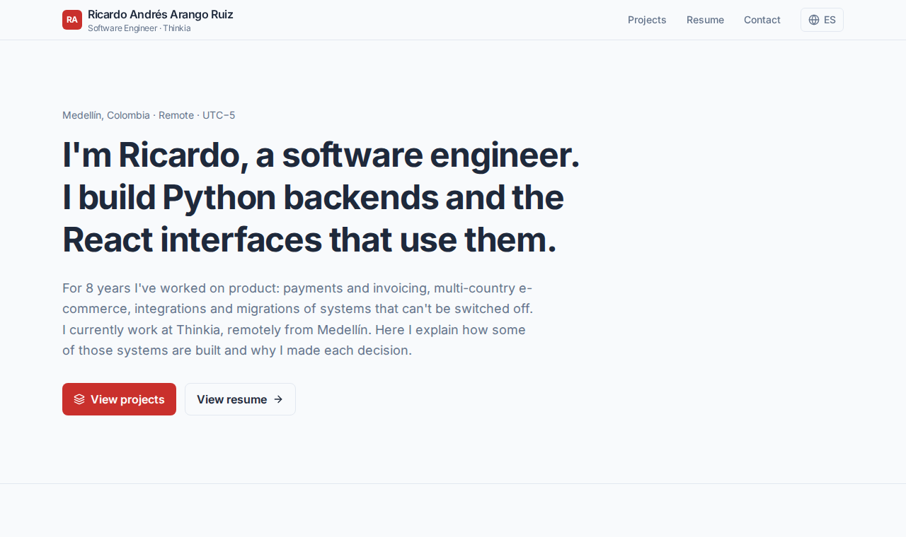
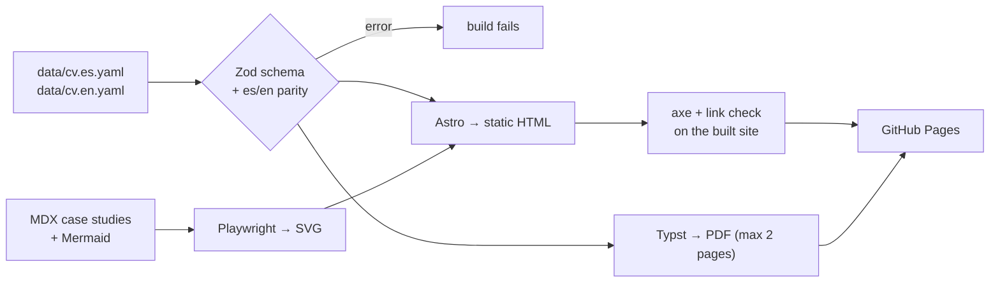

# CV as code

[](https://github.com/inehosa1/cv/actions/workflows/deploy.yml)

My portfolio and resume, built from **a single YAML source** per language:

- **Website** (Spanish and English): https://inehosa1.github.io/cv/ — with [technical case studies](https://inehosa1.github.io/cv/proyectos/) of the systems I have built.
- **ATS-friendly PDF**: [Spanish](https://inehosa1.github.io/cv/cv-es.pdf) · [English](https://inehosa1.github.io/cv/cv-en.pdf).



## How it works



| Layer | Choice | Why |
|---|---|---|
| Data | YAML inspired by [JSON Resume](https://jsonresume.org/schema), validated with Zod 4 | One source for web and PDF; unknown fields and es/en drift fail the build |
| Web | Astro 7, TypeScript (`strictest`), Tailwind CSS 4 | Static HTML; JavaScript only as progressive enhancement (2 small inline scripts) |
| PDF | Typst 0.15 | Reads the YAML natively, real selectable text, single column for ATS parsers |
| Diagrams | Mermaid rendered at build time with Playwright | Diagrams as code, light and dark variants, nothing loaded in the browser |
| Quality | Vitest, Biome, `astro check`, axe-core | Unit tests for the shared logic and an accessibility/link crawl of every page |

## Quality gates

Every push and pull request runs, and a failure blocks the deploy:

1. `pnpm check` — schema and language parity (`scripts/validate.ts`), `astro check`, Biome and the Vitest suite (`tests/`).
2. `pnpm build` — fails if either PDF exceeds two pages.
3. `pnpm check:site` — serves `dist/` and visits every page in the sitemap with Playwright: axe (WCAG 2.2 AA) in light and dark mode, and every internal link and asset must answer 200.

Pull requests also publish both PDFs as a workflow artifact for review. Actions are pinned by SHA and updated by Dependabot.

## Running it locally

Requirements: Node 24 (`.nvmrc`), pnpm 10, [Typst](https://github.com/typst/typst/releases) on the `PATH`, and Playwright's Chromium (`pnpm exec playwright install chromium`).

```bash
pnpm install
pnpm dev          # PDFs + dev server at http://localhost:4321/cv/
pnpm check        # validation, types, lint and unit tests
pnpm build && pnpm check:site
```

Content lives in `data/cv.{es,en}.yaml` and `src/content/projects/{es,en}/*.mdx`; templates never contain CV text. Content and code conventions are in [`AGENTS.md`](AGENTS.md).

## Confidentiality

Most case studies describe client work under NDA. They use generic client descriptions, rounded business figures and no internal names, hosts or code. Metrics come from git history, coverage reports and project documentation.

## License

Code under the [MIT license](LICENSE). The personal content (`data/`, `src/content/`, generated PDFs and images) is not licensed for reuse.
