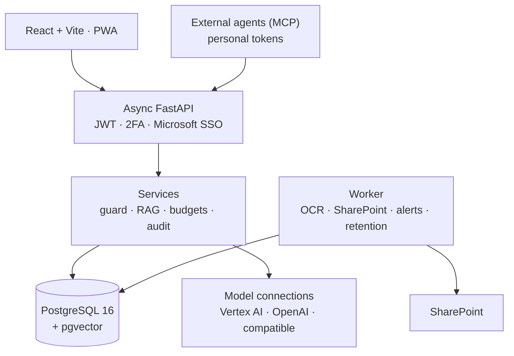
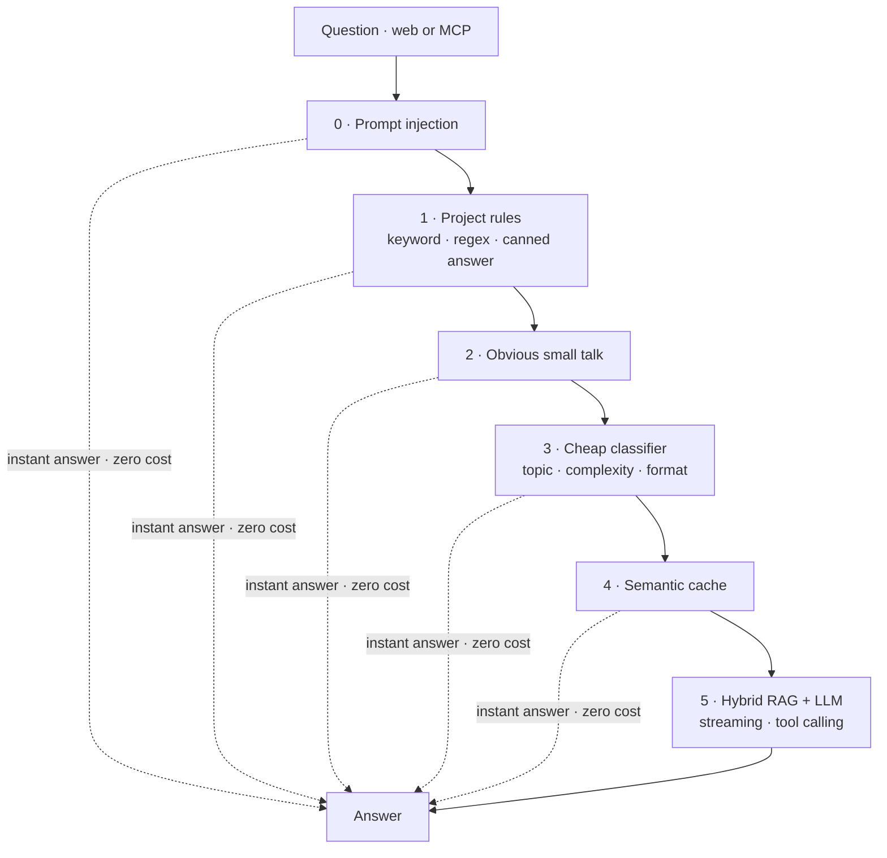

An internal assistant where each team uploads a project's documents and asks questions about them. The challenge was not just answering well but **not spending tokens on what doesn't need them**: small talk, off-topic or already-answered questions. I built it in FastAPI and React, with models configurable from the web app itself.

## Architecture

- **Model providers as plugins**: admins add connections (Vertex AI, OpenAI or any compatible server), test them with a button and pick a model per role and per project. Keys are stored encrypted and the API only returns a masked version.
- **Keyless local mode**: without paid models, an embeddings-and-heuristics classifier and extractive answers that quote the documents make it possible to build and test everything at zero cost.
- **MCP server** (JSON-RPC over Streamable HTTP) so Claude, Copilot or other agents can query projects with the same permissions, budgets and metering as the web app.

## The layered guard

- Every answer records **which route it came from** (rule, cache, off-topic, model…), with its tokens, cost and per-stage timings. That is the basis of the savings metrics.
- The classifier asks **four typed questions in a single call** (topic, complexity, format and whether the question stands on its own). Complexity picks a simple or a complex model, and the last one decides whether the cache can be used.
- If the classifier fails or is slow, the question falls back to the local classifier. An "off-topic" verdict is overridden when the question's words appear in the documents.
- **Hybrid RAG** (vectors + Postgres full-text search) with a trimmed history and a token cap that adapts to what the user prefers.

## Security and privacy

- **Personal data masked** (ID numbers, phones, IBANs, cards, emails) before leaving for any model, and restored in the streamed answer.
- **Prompt-injection defences**: manipulation attempts are blocked for free, and document passages reach the model inside tags it is told never to obey.
- **Tool calling with exact calculators**: the model calls server functions with validated arguments instead of doing the arithmetic.
- Revocable per-device sessions, **mandatory 2FA for admins**, antivirus on every upload, per-document permissions and a backend that refuses to start in production with weak secrets.
- **Monthly budgets** per company, team or project, with alerts and optional pausing of paid answers.

## Operations and quality

- Low-cardinality **Prometheus metrics** and a performance panel with percentiles computed in SQL from the stored answers.
- **Nightly backups** and a restore drill that checks the Alembic revision, extensions and key tables, and returns OK or FAIL.
- A custom **load test** that measures p50/p95/p99 per endpoint. Locally, with 10 concurrent users, the streamed question answers with a 1.5 s p95 and no errors.
- **250+ tests**: backend tests run on real Postgres with deterministic fake embeddings and **93% coverage**, frontend tests with Vitest and Testing Library, plus Playwright e2e smoke tests.
