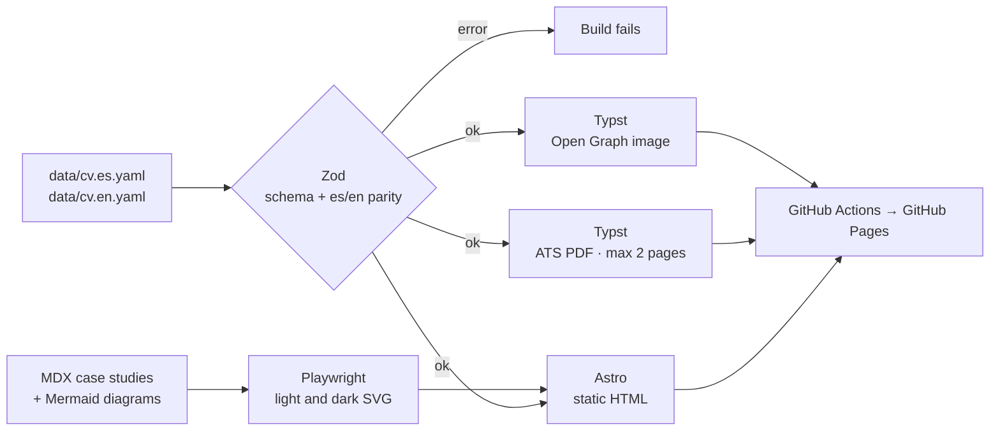

My resume is not edited in a word processor: it is **compiled**. The data lives in a single YAML file per language, and everything else is generated from it: this website, the PDF for ATS systems, the social preview image and the search-engine metadata. The code is public at [github.com/inehosa1/cv](https://github.com/inehosa1/cv).

## Decisions

- **Typst for the PDF.** It reads the YAML directly, compiles in milliseconds and produces real text with embedded fonts in a single column, so ATS systems parse it without errors. The build fails if the resume exceeds two pages.
- **Static HTML, with JavaScript only as progressive enhancement.** Astro generates semantic HTML with dark mode via `prefers-color-scheme`, WCAG AA contrast, JSON-LD and `hreflang`. There are two small inline scripts (the project filter and keeping the scroll position when switching language), and everything still works without them.
- **Diagrams as code.** The diagrams in these case studies are written in Mermaid and rendered at build time with Playwright into SVG, in a light and a dark variant. No library is loaded in the browser.
- **Strict validation.** The schema rejects unknown fields and checks that the Spanish and English versions have exactly the same structure.
- **Privacy.** The phone number only appears in the PDF; never on the website or in the structured data for search engines.

## How it is checked

Every push goes through the same pipeline before it is published:

- **Vitest unit tests** for the shared logic: dates and durations, filters, routes and the structure comparison between languages.
- **`astro check` and Biome**, with TypeScript in `strictest` mode.
- **A Playwright crawl of the built site**: every page in the sitemap is scanned with axe (WCAG 2.2 AA), and every internal link and asset must answer 200. Any failure blocks the deploy.
- **The PDF has a two-page limit** that also fails the build.
