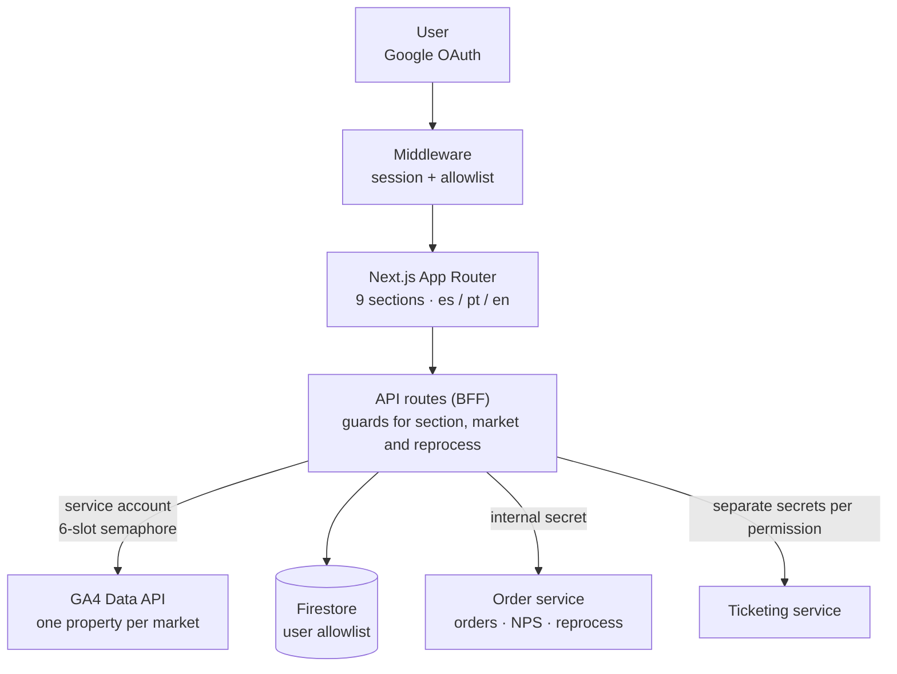
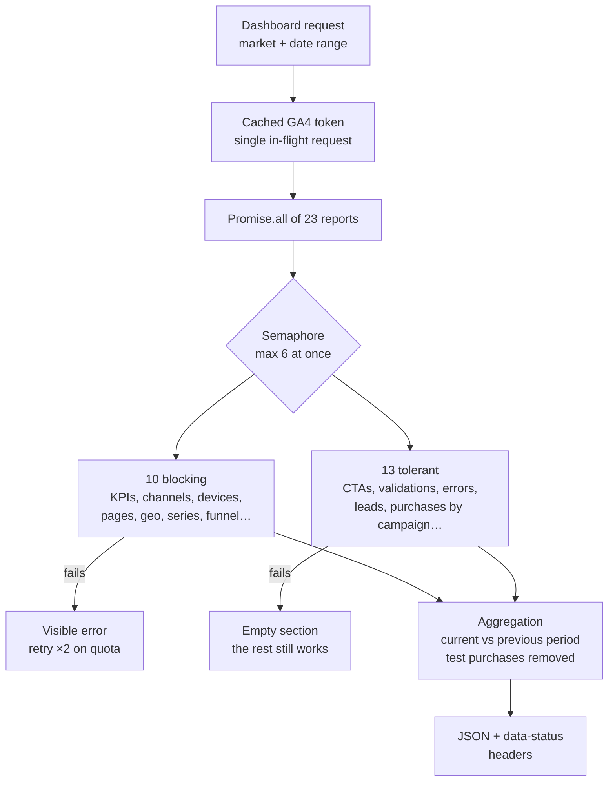
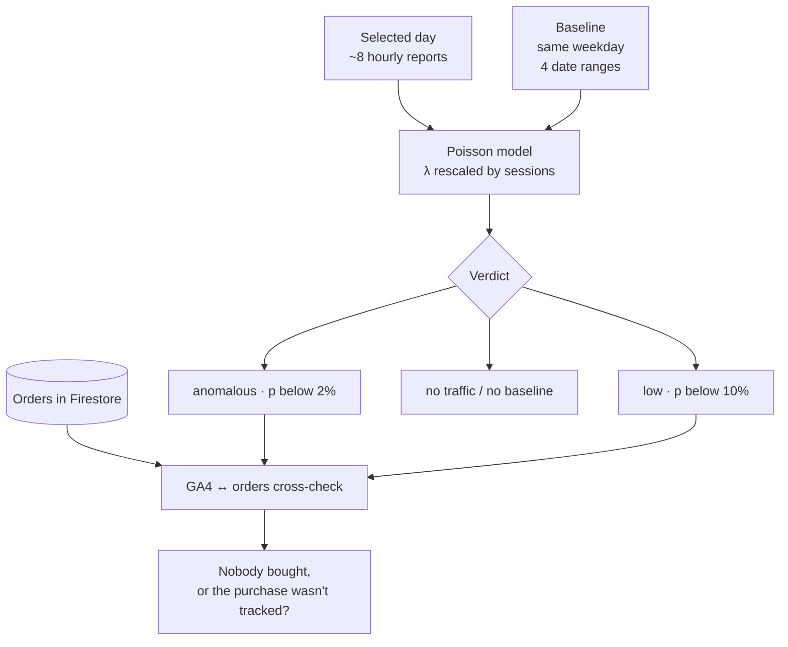

I built an **internal dashboard** that gives the business and marketing team trustworthy numbers and quick answers about daily conversion. It brings traffic, conversion, funnel, orders, NPS and support into one place, with audited numbers split by market (Spain, Portugal and a comparison view).

It is used by business and marketing staff, analysts and admins, each with different permissions.

## Architecture

- **Backend-for-frontend.** The browser never talks to GA4, Firestore or the microservices: everything goes through API routes that check permissions and keep secrets hidden.
- **GA4 via a service account**, separate from user identity. Users need no Google Analytics permissions, and the door is open to scheduled alerts.
- **Per-market configuration with explicit inheritance**: if a market's configuration is missing, the market shows as disabled instead of displaying another country's data.

## Loading the dashboard: 23 reports in parallel without blowing the quota

- GA4 allows 10 concurrent requests per property. A **process-wide semaphore** caps real concurrency at 6, and the access token is cached with a single in-flight request, so one load never mints 22+ tokens.
- Reports are split into **blocking** ones, without which the view makes no sense, and **tolerant** ones that return empty on failure. Quota errors are never presented as empty sections: they are retried with backoff and surfaced.
- **Never fake data.** Without credentials the API returns zeros plus headers that trigger UI banners, so nobody mistakes a demo for reality.

## Funnel rebuilt from URLs

The subscription funnel has 11 steps. I rebuild it from URL parameters (CTA, step, flow and product), with custom events as a fallback. To keep the funnel faithful:

- Drop-off is measured against the **declared total and the next step with traffic**, never against the previous step.
- Mid-funnel entries are shown separately as *"+N enter here"* instead of producing negative drop-off.
- A dedicated report crosses purchases with campaigns per product, preserving attribution across the payment redirect.

## Daily anomaly diagnosis

The dashboard compares the day with previous same weekdays, adjusts the expectation to actual traffic with a **Poisson** model and cross-checks GA4 purchases against real Firestore orders. That separates *"nobody bought"* from *"they bought, but tracking failed"*. Days are bucketed in local time.

## Three-layer permissions

- **Identity** through Google OAuth (only `openid email profile`) and **authorization** through a Firestore allowlist. Permissions are stored expanded on three axes (sections, markets and a reprocess permission), with *admin*, *analyst* and *viewer* role templates, and the JWT re-reads them every 5 minutes.
- **Middleware** that blocks access without a session, **per-route server guards** (the layer that actually protects) and an isomorphic, *fail-closed* function that only decides what the UI draws.
- **Admin safety rules**: nobody can edit or delete themselves, and there is always at least one active admin.

## Numbers you can trust

I built a **metric audit** that judges every figure (impossible, contradictory, zero with a non-zero denominator) against live data and fixtures. Over 5 runs it reached 0 failures and led to two improvements:

- metrics are read by header name instead of by position, guaranteeing every indicator shows the right value;
- each market is verified to read only its own GA4 property.

The **Compare** view uses rates, percentage-point deltas and series rebased to 100, and sends one request per market so one can fail without affecting the other.

## Deployment

A multi-stage Docker image that runs as non-root, with **Cloud Build → Artifact Registry → Cloud Run** and secrets injected from Secret Manager.
