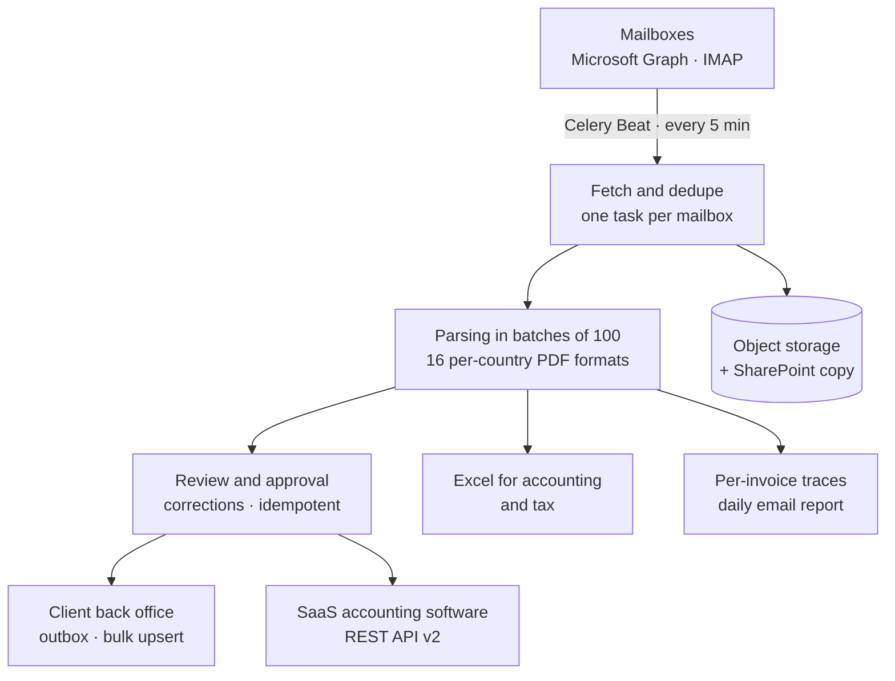
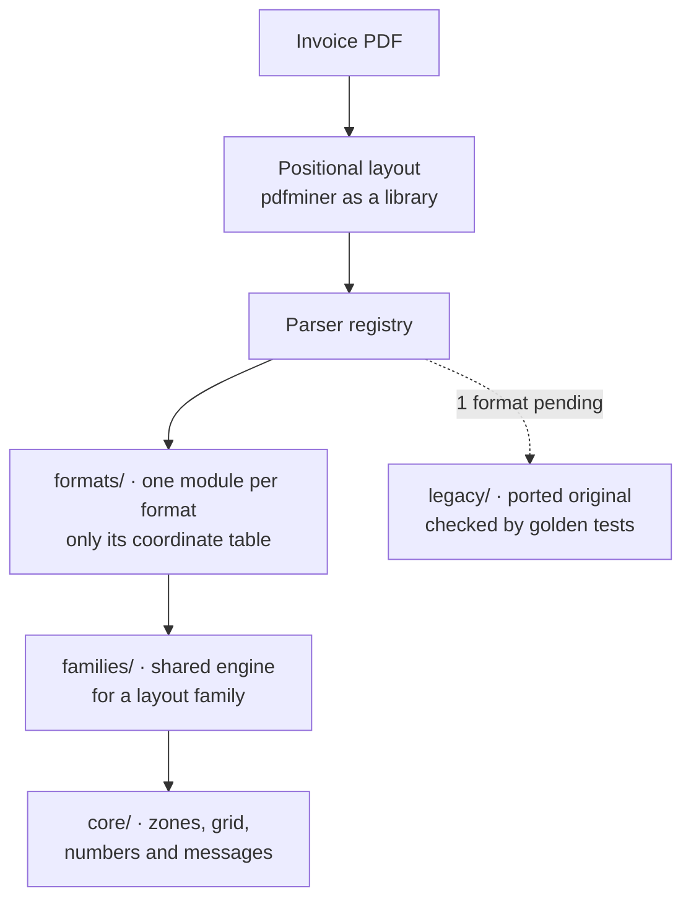

The client received thousands of supplier invoices by email as PDFs, from more than ten countries. Two old, unconnected Django projects fetched and parsed them, and someone had to pass the file paths from one to the other by hand. I **unified them into a single service** with an automatic pipeline: email → attachment → parsing → approval → back office and accounting, with a trace for every invoice.

## Architecture

- **HackSoft Django Styleguide** on a `src/` layout: 9 apps, each with models, services (write side), selectors (read side), an API and thin tasks. Integrations are plain Python clients that take and return dataclasses, with no Django models.
- **The whole flow is asynchronous with Celery Beat**: mail fetching, back-office delivery, archiving, accounting checks and reports, each on its own schedule and behind safety switches that are off by default.
- **Every step creates an execution with its events** in PostgreSQL. A traces API follows any invoice and shows whether it reached its destination, or why not.

## Layered parsers that keep the output

The value of the system lay in each parser's coordinates and rules. There were 16, copy-pasted and run through `os.system`. My rule was **change the shape, never the result**:

- **Golden tests first**: a script runs the original parsers in an isolated environment with their period dependencies and stores their output. Every new parser must reproduce it. That data is real, so it is generated locally and never committed.
- **15 of the 16 formats** are now pure functions `parse(layout) -> ParseOutcome`, with no database, file or network access. An architecture test stops a layer from importing the one above it, or a format from importing another.
- Coordinates live in named constants (`Box(top=…, bottom=…)`) instead of magic numbers.

## Approval and delivery to the target systems

- **Review before sending**: the accounting team can correct the parsed data (number, dates, amounts, VAT, lines), with a record of who and when. The correction wins over the parsed values.
- **Idempotent approvals**: a conditional update makes sure that when two people approve at once, only one wins and the other gets the same trace back.
- **Outbox to the back office** with batched sends. A 429 stops the run without spending retries, and two runs never overlap.
- **Migration to the accounting software's REST API v2**: purchases and credit notes, finding or creating the supplier and the tax for each VAT rate, and a daily send at a fixed hour with optional auto-approval.

## Hard bugs I fixed

- **Mailbox throttling.** Every filter of a mailbox was fetched in parallel and Graph answered 429. Now one task per account walks its filters in series and honours `Retry-After`.
- **Overlapping fetches.** A filter's first fetch took longer than the scheduler interval, which started it again and caused uniqueness clashes. A filter with a fetch in progress is no longer scheduled.
- **Duplicate invoices after a worker restart.** With late acks, a redelivered analysis repeated attachments it had already processed. Analysis now runs in batches of 100 and only handles pending attachments, so a first fetch of thousands of PDFs can be interrupted without losing or duplicating anything.

## Quality and security

- **900+ tests** and **97% branch coverage** (85% gate). The network is blocked with pytest-socket and tests strip any sensitive variable from the environment. Graph, IMAP and SMTP are tested with doubles.
- **Strict mypy** in parsing, mail and integrations. CI runs ruff, mypy, a pending-migrations check and OpenAPI schema validation with no warnings.
- **No secrets in the code**: the legacy configuration is imported with a command that drops credentials and prints which environment variable to set for each account. gitleaks and detect-secrets watch every push.
- I designed out the original system's risks: disk paths and file names sent by the client, shell commands built from attachment names, and bulk deletes without confirmation.
