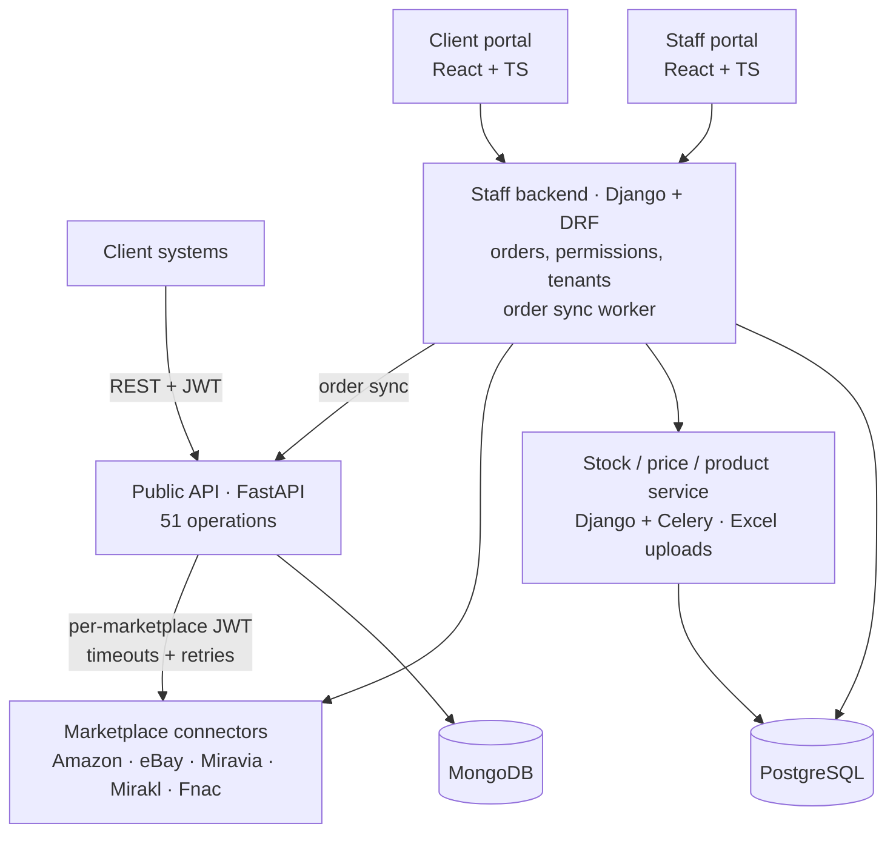
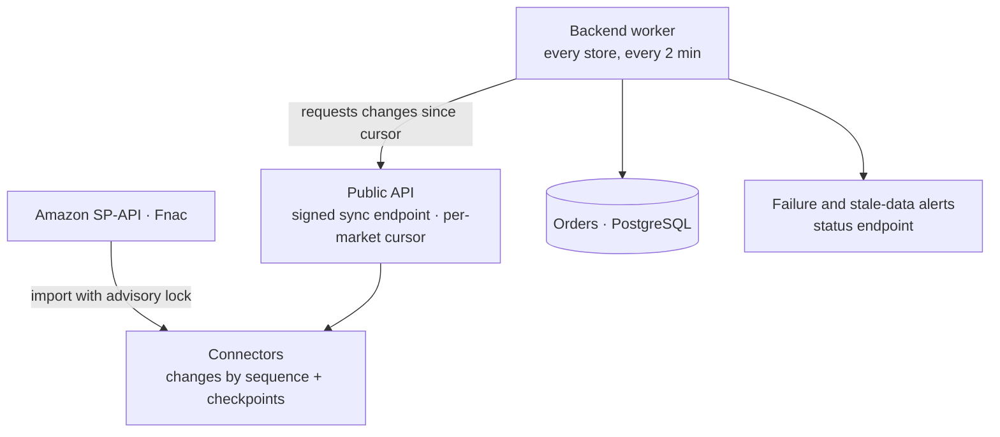
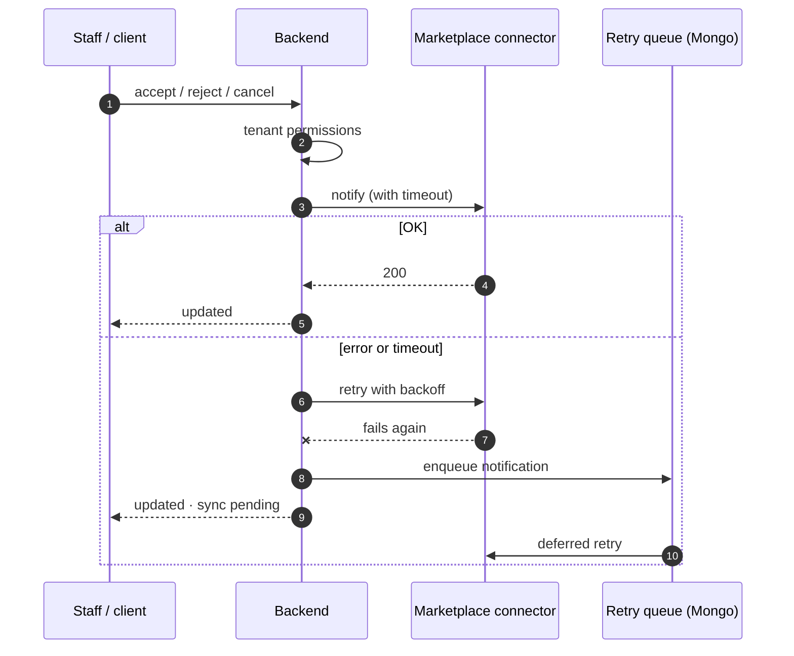
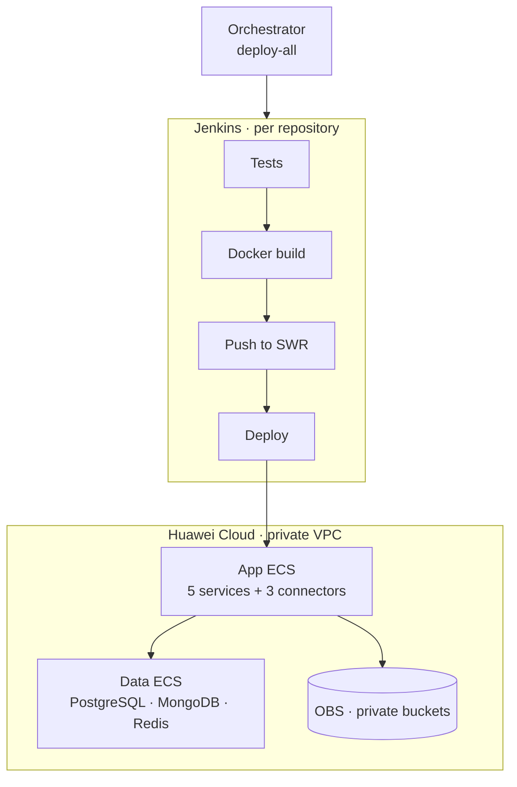

The platform lets retailers manage products, stock, prices, offers and orders across several marketplaces from one place. It is multi-tenant (client → stores → marketplace and country), has one portal for staff and another for clients, and exposes a **public API** so clients' systems can integrate directly.

I worked on it in two phases:

- **2024**: OpenAPI documentation and API schemas, the internal product schema library and eBay integration fixtures.
- **2026**: I was assigned to **help test and integrate** the whole workspace (10 repositories). My contribution focused on the public API, the connectors, tests and new features: security, testing, resilience, automatic order synchronization and support for a cloud-to-cloud migration (GCP → Huawei Cloud).

## Architecture

The data model supports **5 marketplaces**. **Fnac** was the fifth: I added its stock and price support to the public API, the stock service and the portals.

## Hardening the public API (OWASP Top 10)

The public API is the most exposed surface in the system. As part of testing I reviewed it against the **OWASP Top 10** and strengthened each layer:

- **Authentication and authorization**: a mandatory token on every business route, per-marketplace authorization, login **rate limiting** per user and per IP (429 responses) and **optional SSO** with the backend's users and permissions.
- **Input and output**: identifiers are sanitized before being sent to connectors, file uploads are protected against *path traversal*, security headers (CSP, HSTS…) are on, and interactive docs are hidden in production.
- **Errors**: connector failures are mapped to 400, 404, 501 or 502 without leaking internal details.
- **Dependencies**: upgraded Python (3.10 → 3.12), FastAPI and Starlette, and replaced `python-jose` with PyJWT. Vulnerabilities reported by `pip-audit` went from **28 to 0**.
- **Observability**: structured JSON logs with a `request_id`, plus audit events.
- **Containers and pipeline**: a Docker image that runs as non-root and a security-audit stage (pip-audit and bandit) in Jenkins.

I also added **per-market** connector credentials and a **notification queue with retries**, and rewrote the **OpenAPI** spec to document the 51 operations while hiding the signed internal routes.

An early milestone for the suite was going from 396 tests (~92%) to **506 tests with 99% coverage**; today the API has **1,189 tests**. I use `respx` to mock the HTTP connectors and `mongomock-motor` for MongoDB, so no test depends on external services.

## Amazon and Fnac connectors

The **Amazon (SP-API)** and **Fnac** connectors talk directly to the marketplaces and store each seller's credentials. I reviewed them with the same OWASP criteria:

- **Mandatory JWT** on all their endpoints and, for Fnac, an **authenticated gateway** in front.
- **Signed** OAuth `state`, credentials and tokens **encrypted at rest** (Fernet) and safe deserialization of stored data.
- XML parsed with `defusedxml`, **verified TLS** and a **host allowlist** against SSRF.
- Upgraded **Django to 5.2**, a clean `pip-audit` and a migration from **SQLite to PostgreSQL**.
- On SP-API, **retries with backoff** and a **per-seller rate limiter**.
- **Privacy**: buyers' personal data encrypted at rest, email lookup via an HMAC hash, audit events without personal data and a 30-day purge on Amazon.

The connector suites add up to **377** tests for Amazon, **108** for Fnac and **150** for the Fnac orders connector.

## Automatic order synchronization

I built automatic order synchronization end to end, every 2 minutes:

- Connectors expose changes **by sequence with checkpoints**; the import uses a **PostgreSQL advisory lock** so it never runs twice at once, which prevents duplicate orders.
- The public API offers a **signed sync endpoint** with a per-market cursor.
- A backend **worker** syncs every Amazon and Fnac store **every 2 minutes**, with alerts on failure or stale data and a status endpoint.

## Resilient order status changes

So that a slow or unavailable marketplace never leaves orders out of sync, I redesigned the order-line status change flow:

## Django backend and stock service

In the Django backend:

- **Redesigned permission validation** to be safe across concurrent requests.
- Added per-HTTP-method permissions and privilege-escalation checks, rolled out gradually in **`warn` → `enforce`** mode: violations are logged first and blocked later, without breaking existing clients.
- **Login throttling** per account and per IP, protected against `X-Forwarded-For` spoofing.
- A new **Orders API v1 contract** with upserts and filters, catalog publication status synced from the marketplace, soft delete and alerts for expired Amazon credentials.
- Removed the **MongoDB** dependency from this service.
- Over **1,800 tests** in the backend.

In the stock, price and product service I added real validation of Excel uploads, idempotent create endpoints (409/404) and single-product endpoints, and **batch processing in a worker** with chunks and timeouts. I strengthened tenant isolation and the suite reached **1,206 tests**. The container now runs migrations and gunicorn instead of the development server.

## Portals (front ends)

On top of the existing React portals I added:

- An **inventory inbox** with inline and bulk editing, and **tracking of each change** until the marketplace applies it.
- Product creation and editing on a single tabbed page.
- `Secure` + `SameSite=Strict` cookies and a non-root Docker image.

## Cloud-to-cloud migration (GCP → Huawei Cloud)

As part of the integration work I supported moving the **development and integration environment** to Huawei Cloud: pipelines, deployment scripts and end-to-end validation.

- VM-based deployment in a **private VPC**, with restricted security groups and a datastore separated from the apps.
- **8 Jenkins pipelines**: 5 services and 3 connectors, with test, build, push and deploy; the public API's also includes a security-audit stage (pip-audit and bandit). A `deploy.sh` with partial modes and an orchestrator to deploy everything.
- Storage moved from GCS to **OBS** with private buckets.
- I validated the migration end to end.

## AI-assisted development

To test and integrate 10 repositories safely and repeatably, I prepared the working environment for AI-assisted development with **Claude Code** agents:

- **8 specialized subagents**: repo mapping, contract auditing, security auditing, running and writing tests, changelog, connector reading and per-repo work.
- **Skills** to create endpoints and pages and sync schemas, and **hooks** that format Python and validate JSON after every edit.
- **Rules that block reading secrets**, and an `AGENTS.md`/`CLAUDE.md` in every repository with contracts and conventions.
