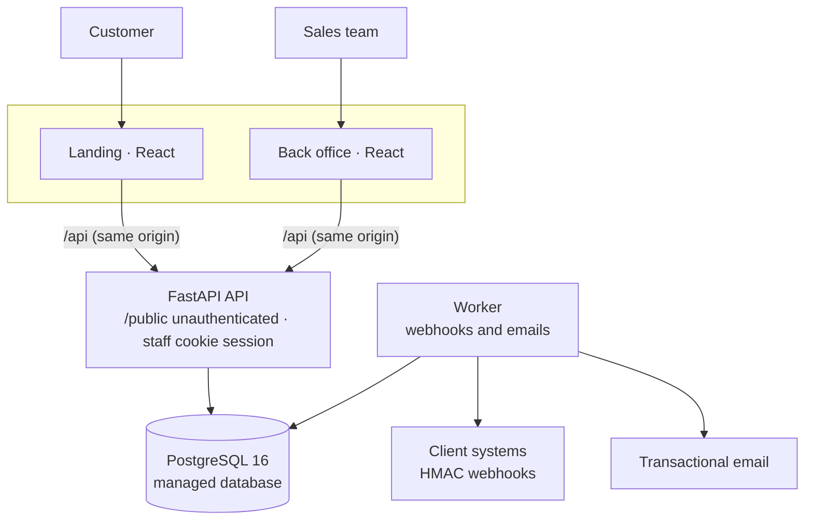
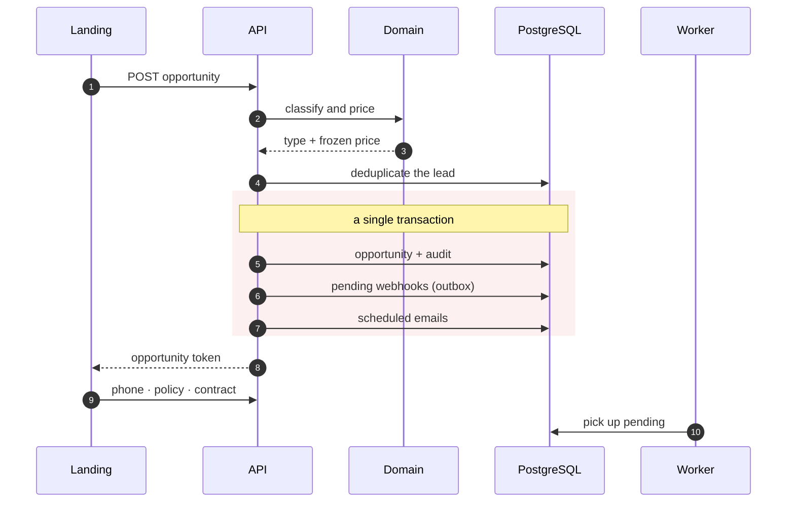
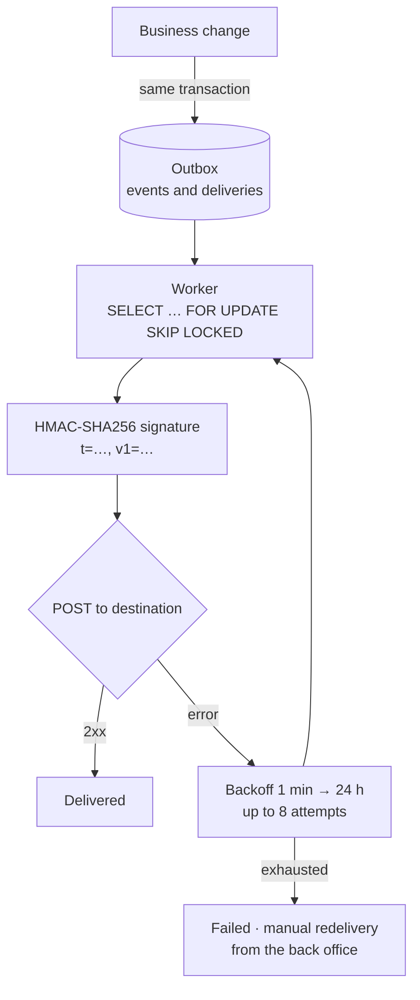
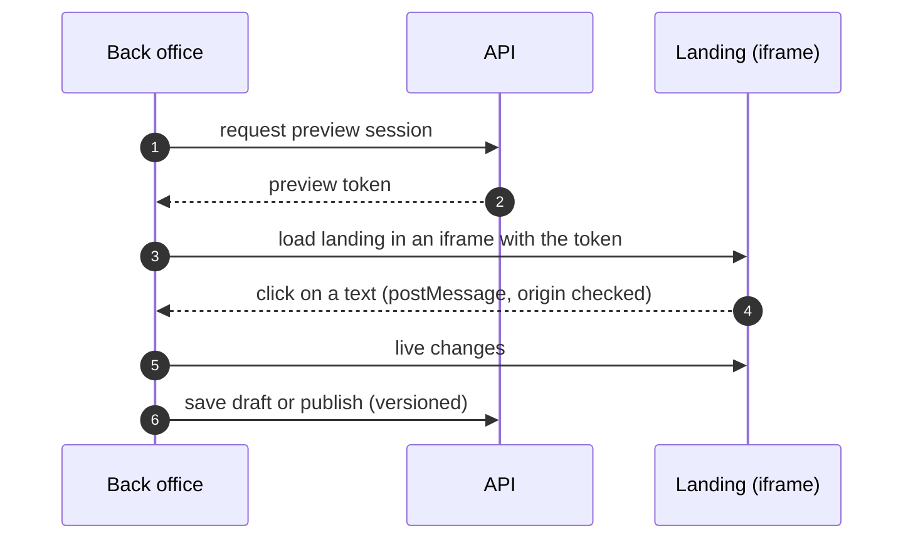

The platform a **leading Spanish insurer** uses to sell its dog and cat insurance online. I built it end to end —the API, both web apps, the infrastructure and the pipelines— and it has been **in production since October 2026**, two weeks after the first commit: 88 commits across 3 repositories and 16 database migrations, with AI-assisted development (Claude Code).

- **Public sign-up landing**: a 3-step quote, a price grid for one or more pets with promo codes, free call-back requests, policy requests, a 2-step online sign-up with 4 payment frequencies and a vet-clinic finder with a map.
- **Mobile-friendly back office for the sales team**: a CRM-style inbox of leads and opportunities, metrics, audit log, users with 4 roles, webhooks, a visual CMS for texts and emails, and admin for pricing, the clinic network and sales channels.

## Sign-up and sales channels

- **Complete sign-up**: extended policyholder details (NIF/NIE, province derived from the postcode…), an editable start date and Spanish phone validation. Optional consent to sales calls is recorded on the lead record and carried in webhooks and exports.
- **Configurable per-channel business rules**: the sales team defines in the back office which flow each traffic source (UTM) is offered. The API enforces the same rules, so they cannot be bypassed from the browser, and a simulator lets them be tested before publishing.
- **Clinic finder** over a nationwide network of vet clinics across Spain, paginated and with a "near me" option: geolocation is rounded to about 100 m and never sent to analytics.

## Architecture

- **Strict one-way layers**: routes → services → repositories → models. Business rules (pricing, permissions, funnel, webhook catalogue, content schemas) live in a **pure domain layer with no I/O**, which is the single source of truth. The front ends only mirror them for display; the server is always the authority.
- **Same origin for each front end**: nginx proxies `/api`, so the session travels in an `httpOnly` `SameSite=Strict` cookie with no CORS setup.
- **Simple, managed infrastructure on GCP**: Docker containers, a managed database on a private network, automatic TLS and managed secrets. Bitbucket Pipelines builds the image and a scripted deployment waits for the services to be healthy; the API applies migrations on startup.

## From quote to contract, in one transaction

- **Versioned pricing and frozen price.** The price is calculated and stored at quote time; tariffs and discounts are versioned by effective date (Europe/Madrid time zone), so a tariff change never alters a quote already issued.
- **Leads only move forward.** Each opportunity is classified by type and can only advance. **Lead deduplication** groups repeated records from the same person and keeps the most advanced one as the main record.
- **Idempotent public POSTs** with an `Idempotency-Key`, so a double click or a network retry never creates two opportunities.

## Webhooks with a transactional outbox

The client's systems receive **17 event types**. So that a network failure never loses or duplicates a business event, I use the **transactional outbox** pattern:

- The event is written **in the same transaction** as the change that triggers it. If the transaction fails, the event does not exist; if it commits, the event will be delivered sooner or later.
- `FOR UPDATE SKIP LOCKED` allows several workers without double deliveries.
- Each destination has its own authentication (bearer, custom header or basic) on top of the signature. Destination URLs go through **SSRF protection**, and secrets and payloads are stored encrypted with Fernet.
- Webhook documentation is generated from the **same builders** that produce real deliveries, and each event can be test-sent from the back office.

**Automated emails** follow the same pattern: the event creates the scheduled message and, when it is due, the worker re-checks the condition, consent, the suppression list and freshness (anything older than 48 h is dropped). Every marketing email carries a signed unsubscribe link and a `List-Unsubscribe` header.

Branded emails were redesigned with **dynamic blocks** (pricing, per-pet summary, masked ID and IBAN), are edited in a **visual editor** in the back office and are sent over SMTP through a transactional provider.

## Visual CMS without deployments

The sales team edits landing and email texts **on the page itself**, without touching code:

- Every editable text carries **invisible zero-width markers** that identify its field, so the HTML does not have to be instrumented by hand.
- Content uses a **safe custom markup** (bold, italic, underline, brand colours and internal links), never free HTML. In emails it is converted to inline styles.
- The CSP `frame-ancestors` and `frame-src` rules only allow these two apps to frame each other.

## Technical SEO and AI search

Both apps are React SPAs, so SEO was solved at build time and in the API:

- **Playwright pre-rendering** inside the Docker build: the home page, the clinic finder, the legal pages and the 404 are served as full HTML. The rest of the SPA is `noindex`, and unknown routes return a **real 404**.
- **50 per-province pages** listing the clinics in each area.
- **JSON-LD structured data**: `InsuranceAgency`, `Service` with `offers`, `FAQPage`, `BreadcrumbList` and each clinic as `VeterinaryCare`.
- `sitemap.xml` with `lastmod` and `llms.txt` generated by the API, plus a `robots.txt` that explicitly allows AI crawlers (GPTBot, ClaudeBot, PerplexityBot…).

## Security and privacy

- **Session**: JWT with a `jti` in an `httpOnly` cookie, double-submit CSRF, argon2 passwords, progressive lockout on failed attempts, a revoked-token list and session invalidation on password change.
- **Sensitive data** (ID documents, IBAN) is **encrypted** in the database. CSV and Excel exports neutralize formula injection, public forms have a *honeypot*, and every response carries security headers.
- The API **refuses to start** in staging or production if it detects development secrets.
- **Privacy-first in-house analytics**: nothing is sent before consent, the backend drops personal data, and each session is linked to its lead to show its path through the 10 funnel steps. Google Ads, Meta and GA4 tags load only with marketing consent.
- **GDPR**: a retention command anonymizes old leads and purges old analytics.

## Quality

- **Backend**: 185 tests against a real PostgreSQL, **97% branch coverage** with a mandatory 90% floor; `mypy --strict`, Ruff with security rules, `pip-audit` and `detect-secrets`.
- **Front ends**: 227 unit tests (100 in the landing and 127 in the back office) with Vitest, Testing Library and MSW, plus **36 Playwright e2e tests** on desktop and mobile, including the password-reset flow through a test mailbox.
- **CI on Bitbucket Pipelines** with parallel quality, security, test and Docker image steps, and hooks that enforce Conventional Commits, block secrets and prevent direct commits to `main`.
- **Load testing** before launch to validate the API's behaviour under concurrency.
