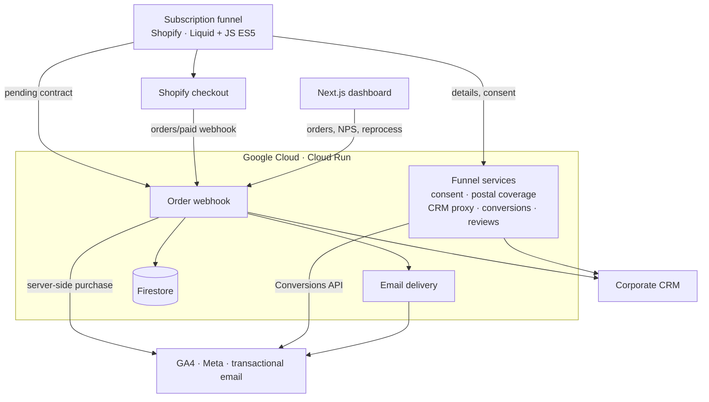
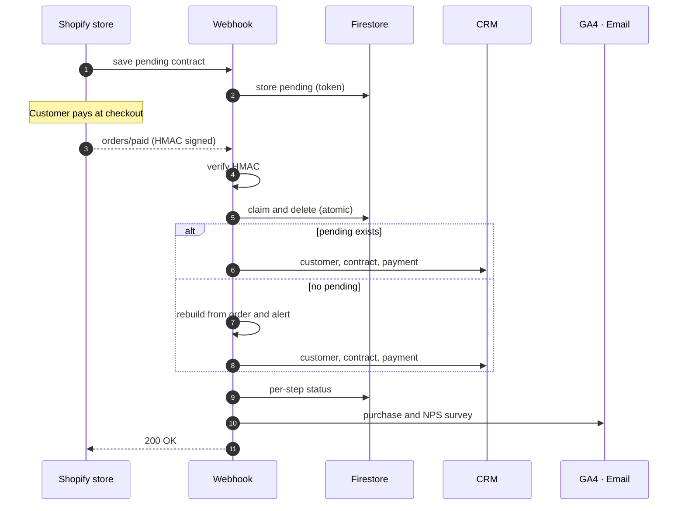
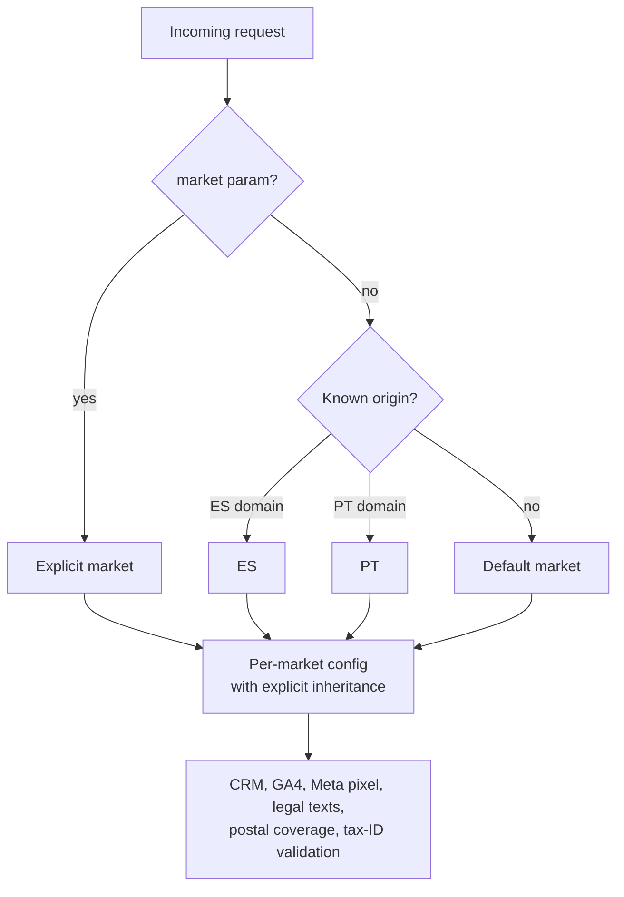
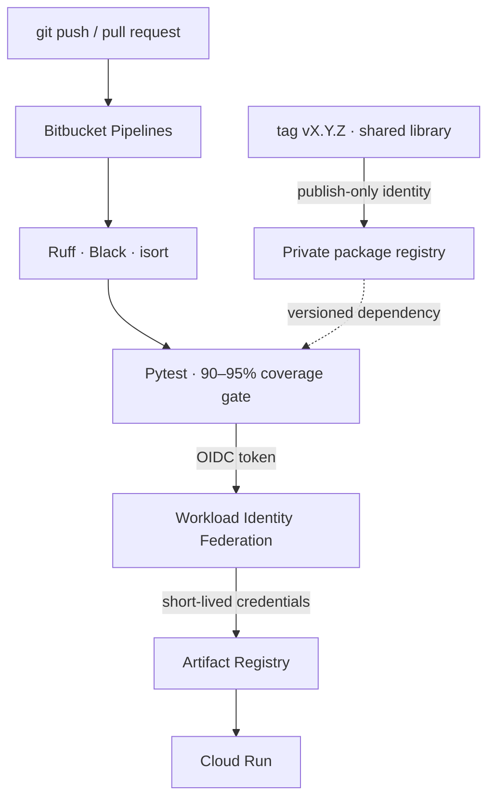

The client, a water treatment multinational, sells water dispensers online as a subscription: the device plus periodic refills. The goal was for **a complete sale to happen with no human involvement**, from the moment a customer picks a plan until the contract is registered in the corporate CRM with its first payment recorded.

I was the technical lead and main developer: the storefront funnel, the microservices, the dashboard, the infrastructure and the technical documentation handed over to the client.

## Architecture

The system has four parts: a **Shopify store** with a custom subscription funnel, **8 serverless microservices on Google Cloud**, a **private dashboard** for analytics and operations, and the **external systems** (CRM, payments, email and measurement).

Each service is small and has a single responsibility. They all share a **versioned internal shared library** that handles the cross-cutting concerns: declarative routing, a uniform error envelope, authentication policies, CORS, logging without personal data and the CRM client. A FastAPI ticketing service and a store-migration CLI round out the ecosystem.

## The order webhook: contracts only after payment

The most important architecture decision was to **create the contract in the payment webhook**, so every contract in the CRM has a confirmed payment.

The funnel stores a **pending contract** in Firestore, keyed by an unguessable token tied to the cart. Shopify confirms payment with the `orders/paid` webhook, and the backend completes the whole onboarding:

What makes this flow robust:

- **Fail-closed authentication.** The webhook endpoint requires Shopify's HMAC signature computed over the raw body and rejects the request whenever the configuration is incomplete.
- **Atomic de-duplication.** Shopify guarantees *at-least-once* delivery: it retries up to 19 times over 48 h and can deliver the same event twice almost simultaneously. The pending contract is claimed and deleted inside a Firestore transaction, so only one delivery can create the contract.
- **Rebuild.** If the pending contract is missing, it is rebuilt from the order and a Sentry alert is raised for follow-up.
- **Per-step status and idempotency.** A per-order status record tracks the contract, payment, GA4 and NPS separately. The dashboard's **"Reprocess"** button retries only the failed steps, never duplicates analytics, and is the only manual action allowed to write to the CRM.
- **Automatic recovery.** A scheduled job reprocesses failed orders from the last 48 h, per market and idempotently. Another scheduled job retries leads that could not be registered in the CRM.
- **Robust integration with the corporate CRM.** Explicit timeouts, our own idempotency through an `Idempotency-Key` header, and verified TLS.

## One codebase, two markets

The expansion to **Portugal** was designed as multi-market in code, not as a copy of the project:

- The **Portugal theme** (its own repository, 113 commits) was cloned from Spain's and translated to **European Portuguese**: a dictionary of about 200 keys that keeps the analytics keys and translates only the values, with a documented manual translation review.
- I centralized **Portuguese format validation** (phone, `NNNN-NNN` postal code with auto-formatting, and NIF tax ID), replacing about 30 duplicated validations.
- **Per-country analytics**: separate GA4 property, Meta pixel and server-side Meta CAPI per market. Portugal also has its own cookie consent, legal policies, CRM catalog and pricing, and Google reviews per market and language.
- **Per-product postal coverage** with a *deny-list* model: non-existent postal codes and unserved areas (islands) are rejected before payment.
- I built a **store migration CLI** (products, collections, metafields and referenced metaobjects) on the **Shopify Admin GraphQL API**, with OAuth and checks on the token's scopes and store before writing. It is idempotent, runs *dry-run* first, paginates past the 250-node limit, translates copy but never handles, and is non-destructive by design: among its 80 tests, one guarantees it contains no delete mutation.
- Every service has a **dedicated deployment per market**. Both markets share Firestore and every order is tagged with its market.

## Keyless CI/CD and quality

- **No stored service-account keys.** CI authenticates to GCP with Bitbucket OIDC tokens and Workload Identity Federation. One read-only identity serves every repository, and a separate publishing identity is bound only to the library repository, which protects the supply chain.
- **Mandatory coverage gates** of 90–95% in every service (measured coverage is 94–99%), with **more than 1,100 tests**. None of them touch the real network or database: adapters are injected.
- **A `deploy.sh` per service**: it requires a clean git tree, runs the tests, builds the image, smoke-tests the container before deploying, and lets you choose the target market.
- **Theme deploy guard**: the push is refused if the live theme was edited in the Shopify admin since the last deploy, so those changes are never overwritten.
- **An OWASP Top 10 audit** with 10 findings fixed shaped the library's design: authentication on every endpoint, fail-closed HMAC, restricted CORS, XSS-safe third-party content, secrets out of the code and verified TLS to the CRM. Authentication policies are declarative and *fail-closed* by default (public, browser origin, shared secret with constant-time comparison, Shopify HMAC), and errors never expose internal details.

## Server-side measurement and in-app browsers

- The purchase is sent to **GA4 via the Measurement Protocol** from the backend, carrying the browser's `client_id` and `session_id` so attribution is not lost. **Meta Conversions API** events are de-duplicated against the browser pixel with a shared `event_id`, and personal data is sent hashed.
- **Compatibility with in-app browsers** and Samsung Internet: the funnel is written in **ES5** (no `async/await` or `?.`) and, using **Sentry Session Replay**, I diagnosed and fixed a rendering issue specific to those browsers. The pay button fires parallel calls with strict timeouts and a *warm-up* call that avoids 2–3 s cold starts.

## Operations dashboard and tickets

Two parts of the ecosystem have their own case study:

- **[Analytics and operations dashboard](../dashboard-analitica/)**: a Next.js dashboard that loads 23 GA4 reports in parallel, rebuilds the funnel, diagnoses daily anomalies with a Poisson model and reprocesses orders in one click.
- **[Maintenance tracking with SLAs](../tickets-mantenimiento/)**: the FastAPI service that replaced a spreadsheet-based low-code workflow, with a state machine, transactional IDs, SLAs and an hours bank.

## Outcomes

- Online sales run **end to end with no manual intervention**, and every contract in the CRM has a confirmed payment.
- There is **full visibility** into every order, with scheduled automatic reprocessing and one-click recovery when an external system fails.
- The second country launched **without duplicating the codebase**.
- The 8 microservices share an audited common foundation, with secretless CI/CD and more than 1,100 tests.
- I delivered a **technical manual** of about 1,300 lines with 12 diagrams generated from code.
