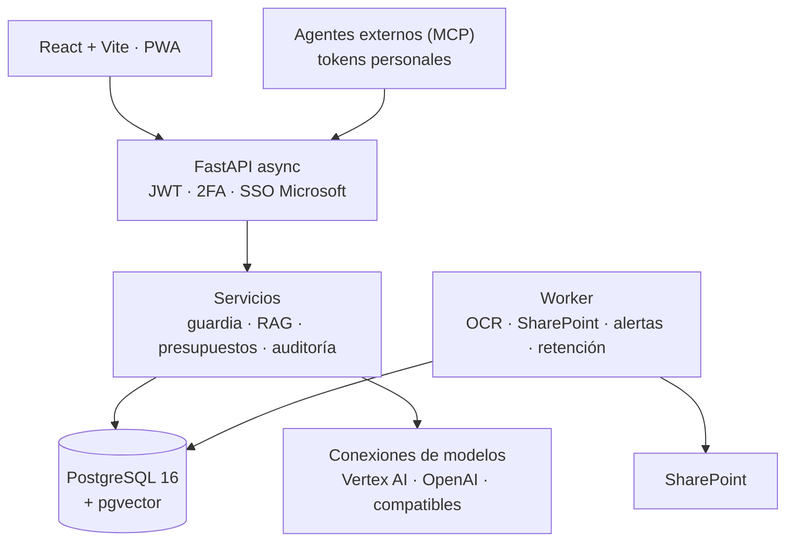
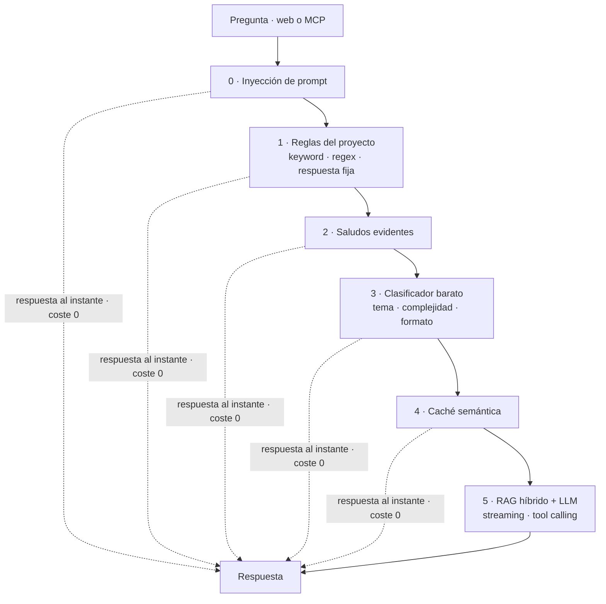

Un asistente interno en el que cada equipo sube los documentos de un proyecto y hace preguntas sobre ellos. El reto no era solo responder bien, sino **no gastar tokens en lo que no lo necesita**: saludos, preguntas fuera de tema o ya respondidas. Lo construí en FastAPI y React, con modelos configurables desde la propia web.

## Arquitectura

- **Proveedores de modelos como plugins**: el administrador añade conexiones (Vertex AI, OpenAI o cualquier servidor compatible), las prueba con un botón y elige un modelo por rol y por proyecto. Las claves se guardan cifradas y la API solo devuelve una versión enmascarada.
- **Modo local sin claves**: sin modelos de pago, un clasificador con embeddings y heurísticas y respuestas extractivas citando los documentos permiten desarrollar y probar todo a coste cero.
- **Servidor MCP** (JSON-RPC sobre Streamable HTTP) para que Claude, Copilot u otros agentes consulten los proyectos con los mismos permisos, presupuestos y medición que la web.

## La guardia por capas

- Cada respuesta registra **por qué ruta salió** (regla, caché, fuera de tema, modelo…), con sus tokens, coste y tiempos por etapa. Es la base de las métricas de ahorro.
- El clasificador hace **cuatro preguntas tipadas en una sola llamada** (tema, complejidad, formato y si la pregunta se entiende sola). La complejidad elige un modelo simple o uno complejo, y la última decide si se puede usar la caché.
- Si el clasificador falla o tarda, la pregunta pasa al clasificador local. Un veredicto de «fuera de tema» se anula cuando las palabras de la pregunta aparecen en los documentos.
- **RAG híbrido** (vectores + búsqueda de texto completo en Postgres) con historial recortado y un tope de tokens que se adapta a lo que el usuario prefiere.

## Seguridad y privacidad

- **Datos personales enmascarados** (documentos de identidad, teléfonos, IBAN, tarjetas, emails) antes de salir hacia cualquier modelo, y restaurados en la respuesta en streaming.
- **Defensas contra inyección de prompt**: las peticiones de manipulación se bloquean gratis, y los fragmentos de documentos van al modelo dentro de etiquetas que se le indica no obedecer.
- **Tool calling con calculadoras exactas**: el modelo llama a funciones del servidor con argumentos validados en lugar de hacer la aritmética.
- Sesiones por dispositivo revocables, **2FA obligatorio para administradores**, antivirus en cada subida, permisos por documento y un backend que se niega a arrancar en producción con secretos débiles.
- **Presupuestos mensuales** por empresa, equipo o proyecto, con avisos y pausa opcional de las respuestas de pago.

## Operación y calidad

- **Métricas Prometheus** de baja cardinalidad y un panel de rendimiento con percentiles calculados en SQL a partir de las respuestas guardadas.
- **Copias de seguridad nocturnas** y un simulacro de restauración que comprueba la revisión de Alembic, las extensiones y las tablas clave, y devuelve OK o FAIL.
- **Prueba de carga** propia que mide p50/p95/p99 por endpoint. En local, con 10 usuarios simultáneos, la pregunta en streaming responde con un p95 de 1,5 s y sin errores.
- **250+ tests**: los de backend corren sobre Postgres real con embeddings falsos deterministas y un **93 % de cobertura**, y los de frontend con Vitest y Testing Library, más humo e2e con Playwright.
