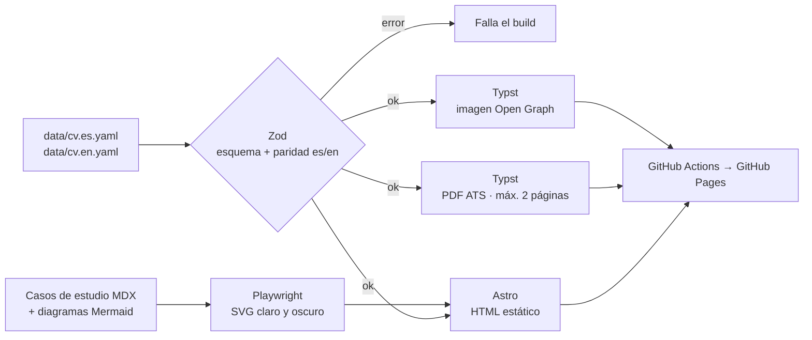

Mi CV no se edita en un procesador de texto: se **compila**. Los datos viven en un único YAML por idioma y todo lo demás se genera a partir de ellos: esta web, el PDF para los sistemas ATS, la imagen para redes sociales y los metadatos para buscadores. El código es público en [github.com/inehosa1/cv](https://github.com/inehosa1/cv).

## Decisiones

- **Typst para el PDF.** Lee el YAML directamente, compila en milisegundos y produce texto real con las fuentes embebidas, en una sola columna, para que los ATS lo interpreten sin errores. El build falla si el CV supera las dos páginas.
- **HTML estático y JavaScript solo como mejora progresiva.** Astro genera HTML semántico con modo oscuro por `prefers-color-scheme`, contraste WCAG AA, JSON-LD y `hreflang`. Hay dos scripts inline pequeños (el filtro de proyectos y conservar el scroll al cambiar de idioma) y sin ellos todo sigue funcionando.
- **Diagramas como código.** Los diagramas de estos casos de estudio se escriben en Mermaid y se renderizan en build con Playwright a SVG, en una variante clara y otra oscura. No se carga ninguna librería en el navegador.
- **Validación estricta.** El esquema rechaza campos desconocidos y comprueba que la versión en español y la versión en inglés tengan exactamente la misma estructura.
- **Privacidad.** El teléfono solo aparece en el PDF; nunca en la web ni en los datos estructurados para buscadores.

## Cómo se comprueba

Cada push pasa por el mismo pipeline antes de publicarse:

- **Tests unitarios con Vitest** para la lógica compartida: fechas y duraciones, filtros, rutas y la comparación de estructura entre idiomas.
- **`astro check` y Biome** con TypeScript en modo `strictest`.
- **Un recorrido del sitio construido con Playwright**: cada página del sitemap se analiza con axe (WCAG 2.2 AA) y se comprueba que todos los enlaces y recursos internos respondan 200. Cualquier fallo bloquea el despliegue.
- **El PDF tiene un límite de dos páginas** que también hace fallar el build.
