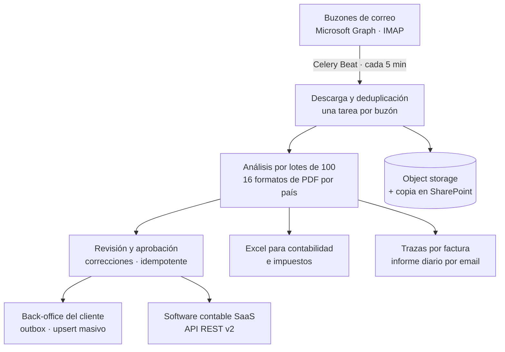
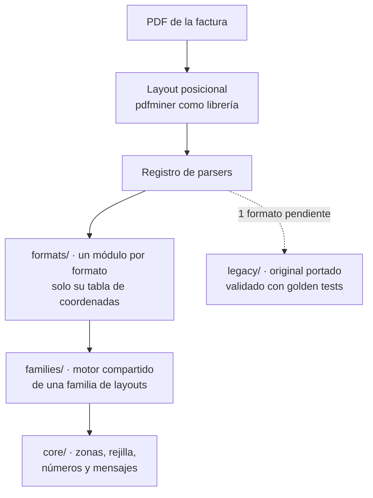

El cliente recibía por correo miles de facturas de proveedores en PDF, de más de una decena de países. Dos proyectos Django antiguos, sin conexión entre sí, las descargaban y las analizaban, y una persona tenía que pasar las rutas de uno a otro a mano. Los **unifiqué en un único servicio** con un pipeline automático: correo → adjunto → análisis → aprobación → back-office y contabilidad, con una traza por cada factura.

## Arquitectura

- **HackSoft Django Styleguide** sobre un layout `src/`: 9 apps, cada una con modelos, servicios (escritura), selectores (lectura), API y tareas finas. Las integraciones son clientes Python puros que reciben y devuelven dataclasses, sin modelos de Django.
- **Todo el flujo es asíncrono con Celery Beat**: descarga del correo, envío al back-office, archivo, comprobaciones contables e informes, cada uno con su propio horario e interruptores de seguridad apagados por defecto.
- **Cada paso crea una ejecución con sus eventos** en PostgreSQL. Una API de trazas permite seguir cualquier factura y ver si llegó a su destino o por qué no.

## Parsers por capas, sin cambiar el resultado

El valor del sistema estaba en las coordenadas y reglas de cada parser. Había 16, copiados entre sí y ejecutados con `os.system`. Mi regla fue **cambiar la forma, nunca el resultado**:

- **Golden tests primero**: un script ejecuta los parsers originales en un entorno aislado con sus dependencias de la época y guarda su salida. Cada parser nuevo tiene que reproducirla. Esos datos son reales, así que se generan en local y nunca se versionan.
- **15 de los 16 formatos** ya son funciones puras `parse(layout) -> ParseOutcome`, sin acceso a base de datos, ficheros ni red. Un test de arquitectura impide que una capa importe a la de arriba o que un formato importe a otro.
- Las coordenadas viven en constantes con nombre (`Box(top=…, bottom=…)`) en lugar de números mágicos.

## Aprobación y envío a los sistemas de destino

- **Revisión antes de enviar**: el equipo de contabilidad puede corregir los datos analizados (número, fechas, importes, IVA, líneas), con registro de quién y cuándo. La corrección gana sobre el análisis.
- **Aprobaciones idempotentes**: una actualización condicional garantiza que, si dos personas aprueban a la vez, solo gana una y la otra recibe la misma traza.
- **Outbox hacia el back-office** con envío por lotes. Un 429 detiene la ejecución sin gastar reintentos y nunca hay dos envíos en paralelo.
- **Migración al API REST v2 del software contable**: alta de compras y abonos, búsqueda o creación del proveedor y del impuesto de cada tipo de IVA, y envío diario a una hora fija con autoaprobación opcional.

## Bugs difíciles que resolví

- **Throttling del buzón.** Todos los filtros de un buzón se descargaban en paralelo y Graph respondía 429. Ahora hay una tarea por cuenta que recorre sus filtros en serie y respeta `Retry-After`.
- **Descargas que se pisaban.** La primera descarga de un filtro tardaba más que el intervalo del planificador, que la volvía a lanzar y provocaba choques de unicidad. Un filtro con una descarga en curso ya no se planifica.
- **Facturas duplicadas tras reiniciar un worker.** Con *acks* tardíos, un análisis reentregado repetía adjuntos ya procesados. El análisis va ahora en lotes de 100 y solo procesa los adjuntos pendientes, así que una primera descarga de miles de PDF se puede interrumpir sin perder ni duplicar nada.

## Calidad y seguridad

- **900+ tests**, con un **97 % de cobertura con ramas** (mínimo 85 %). La red está bloqueada con pytest-socket y los tests eliminan del entorno cualquier variable sensible. Graph, IMAP y SMTP se prueban con dobles.
- **mypy en modo estricto** en análisis, correo e integraciones. En CI pasan ruff, mypy, la comprobación de migraciones pendientes y la validación del esquema OpenAPI sin warnings.
- **Ningún secreto en el código**: la configuración heredada se importa con un comando que descarta las credenciales e indica qué variable de entorno definir para cada cuenta. gitleaks y detect-secrets vigilan cada push.
- Eliminé del diseño los riesgos del sistema original: rutas de disco y nombres de fichero enviados por el cliente, comandos de shell con nombres de adjuntos y borrados masivos sin confirmación.
