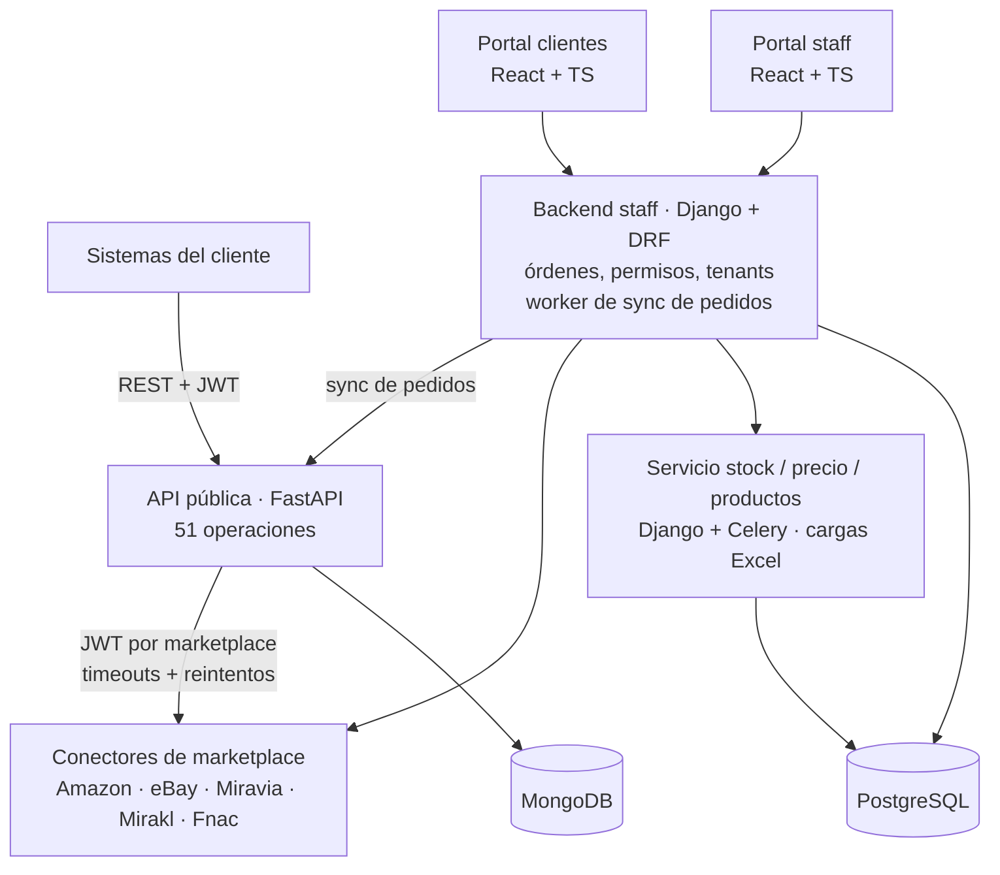
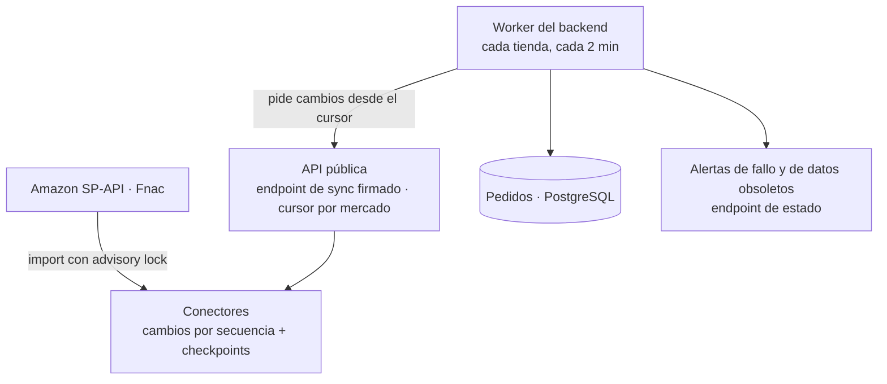
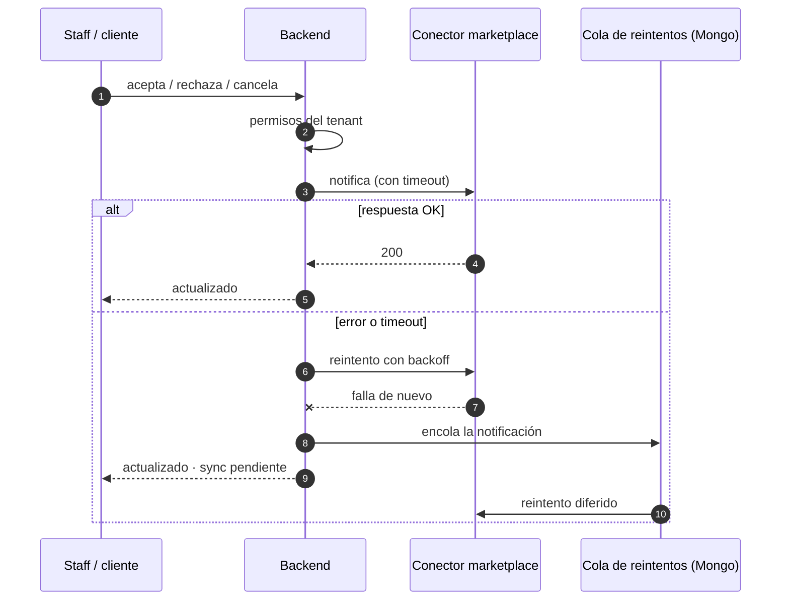
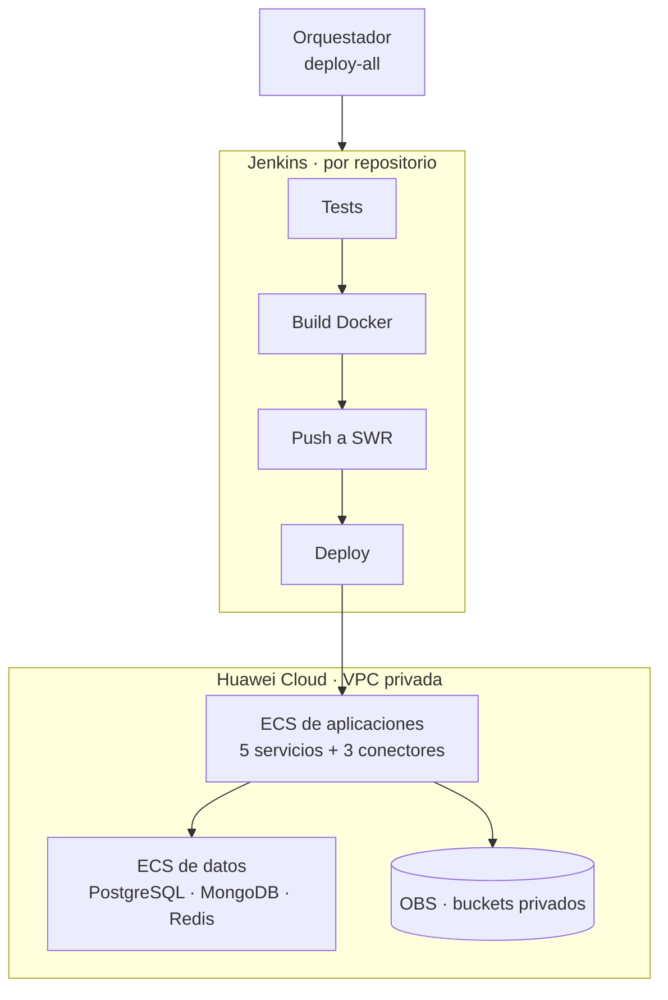

La plataforma permite a los retailers gestionar desde un solo lugar productos, stock, precios, ofertas y pedidos en varios marketplaces. Es multi-tenant (cliente → tiendas → marketplace y país), tiene un portal para el staff y otro para los clientes, y ofrece una **API pública** para que los sistemas de los clientes se integren directamente.

Participé en dos etapas:

- **2024**: documentación OpenAPI y esquemas de la API, la librería interna de esquemas de producto y *fixtures* de integración con eBay.
- **2026**: me asignaron para **ayudar a probar e integrar** todo el workspace (10 repositorios). Mi aporte se centró en la API pública, los conectores, los tests y nuevas funcionalidades: seguridad, testing, resiliencia, la sincronización automática de pedidos y apoyo en la migración entre nubes (GCP → Huawei Cloud).

## Arquitectura

El modelo de datos admite **5 marketplaces**. **Fnac** fue el quinto: añadí su soporte de stock y precio en la API pública, el servicio de stock y los portales.

## Blindaje de la API pública (OWASP Top 10)

La API pública es la superficie más expuesta del sistema. Como parte de las pruebas la revisé contra el **OWASP Top 10** y reforcé cada capa:

- **Autenticación y autorización**: token obligatorio en todas las rutas de negocio, autorización por marketplace, **rate limiting** del login por usuario y por IP (respuesta 429) y **SSO opcional** con los usuarios y permisos del backend.
- **Entrada y salida**: los identificadores se sanean antes de enviarlos a los conectores, las subidas de ficheros tienen protección contra *path traversal*, las cabeceras de seguridad (CSP, HSTS…) están activas y la documentación interactiva se oculta en producción.
- **Errores**: los fallos del conector se traducen a 400, 404, 501 o 502 sin filtrar detalles internos.
- **Dependencias**: actualicé Python (3.10 → 3.12), FastAPI y Starlette y sustituí `python-jose` por PyJWT. Las vulnerabilidades reportadas por `pip-audit` bajaron de **28 a 0**.
- **Observabilidad**: logs JSON estructurados con `request_id` y eventos de auditoría.
- **Contenedores y pipeline**: imagen Docker que se ejecuta sin root y una etapa de auditoría de seguridad (pip-audit y bandit) en Jenkins.

Además añadí credenciales de conector **por mercado**, una **cola de avisos con reintentos** y reescribí la especificación **OpenAPI** para documentar las 51 operaciones ocultando las rutas internas firmadas.

Un primer hito de la suite fue pasar de 396 tests (~92 %) a **506 tests con un 99 % de cobertura**; hoy la API tiene **1.189 tests**. Uso `respx` para simular los conectores HTTP y `mongomock-motor` para MongoDB, así que ningún test depende de servicios externos.

## Conectores de Amazon y Fnac

Los conectores de **Amazon (SP-API)** y **Fnac** son los que hablan directamente con los marketplaces y guardan las credenciales de cada vendedor. Los revisé con el mismo criterio OWASP:

- **JWT obligatorio** en todos sus endpoints y, para los de Fnac, un **gateway con autenticación** delante.
- `state` de OAuth **firmado**, credenciales y tokens **cifrados en reposo** (Fernet) y deserialización segura de los datos guardados.
- XML procesado con `defusedxml`, **TLS verificado** y **lista blanca de hosts** contra SSRF.
- Actualicé **Django a 5.2**, `pip-audit` limpio y migración de **SQLite a PostgreSQL**.
- En SP-API, **reintentos con backoff** y un **rate limiter por vendedor**.
- **Privacidad**: datos personales de compradores cifrados en reposo, búsqueda por email mediante hash HMAC, eventos de auditoría sin datos personales y purga a los 30 días en Amazon.

Las suites de los conectores suman **377** tests en Amazon, **108** en Fnac y **150** en el conector de pedidos de Fnac.

## Sincronización automática de pedidos

Construí de punta a punta la sincronización automática de pedidos, cada 2 minutos:

- Los conectores exponen los cambios **por secuencia con checkpoints**; la importación usa un **advisory lock de PostgreSQL** para no ejecutarse dos veces a la vez, lo que evita pedidos duplicados.
- La API pública ofrece un **endpoint de sincronización firmado** con un cursor por mercado.
- Un **worker** del backend sincroniza cada tienda de Amazon y Fnac **cada 2 minutos**, con alertas si falla o si los datos se quedan obsoletos y un endpoint de estado.

## Resiliencia en los cambios de estado de pedidos

Para que un marketplace caído o lento no deje pedidos desincronizados, rediseñé el flujo de cambios de estado de las líneas de pedido:

## Backend Django y servicio de stock

En el backend Django:

- **Rediseñé la validación de permisos** para que fuera segura entre peticiones concurrentes.
- Añadí permisos por método HTTP y bloqueo de escalada de privilegios, con un despliegue gradual **`warn` → `enforce`**: primero se registran las violaciones y después se bloquean, sin romper a los clientes existentes.
- **Throttling del login** por cuenta y por IP, protegido contra la suplantación de `X-Forwarded-For`.
- Nuevo **contrato de Orders API v1** con upserts y filtros, estado de publicación del catálogo sincronizado desde el marketplace, borrado lógico y alertas de credenciales de Amazon caducadas.
- Eliminé la dependencia de **MongoDB** en este servicio.
- Más de **1.800 tests** en el backend.

En el servicio de stock, precios y productos añadí validación real de las cargas Excel, endpoints de creación idempotentes (409/404) y de producto individual, y procesamiento por **lotes en un worker** con *chunks* y timeouts. Reforcé el aislamiento entre tenants y la suite llegó a **1.206 tests**. El contenedor ahora ejecuta migraciones y gunicorn en lugar del servidor de desarrollo.

## Portales (frontends)

Sobre los portales React existentes añadí:

- **Bandeja de inventario** con edición en línea y por lotes, y **seguimiento de cada cambio** hasta que el marketplace lo aplica.
- Alta y edición de producto en una página con pestañas.
- Cookies `Secure` + `SameSite=Strict` e imagen Docker sin root.

## Migración entre nubes (GCP → Huawei Cloud)

Como parte del trabajo de integración apoyé el paso a Huawei Cloud del **entorno de desarrollo e integración**: pipelines, scripts de despliegue y validación de punta a punta.

- Despliegue sobre VMs con una **VPC privada**, security groups restringidos y un *datastore* separado de las aplicaciones.
- **8 pipelines Jenkins**: 5 servicios y 3 conectores, con test, build, push y deploy; el de la API pública incluye además una etapa de auditoría de seguridad (pip-audit y bandit). Un `deploy.sh` con modos parciales y un orquestador para desplegar todo.
- Almacenamiento de GCS a **OBS** con buckets privados.
- Validé la migración de punta a punta.

## Desarrollo asistido por IA

Para probar e integrar 10 repositorios de forma segura y repetible, preparé el entorno de trabajo para desarrollo asistido por IA con agentes de **Claude Code**:

- **8 subagentes especializados**: mapeo de repos, auditoría de contratos, auditoría de seguridad, ejecución y escritura de tests, changelog, lectura de conectores y trabajo por repositorio.
- **Skills** para crear endpoints, páginas y sincronizar esquemas, y **hooks** que formatean Python y validan JSON después de cada edición.
- **Reglas que impiden leer secretos** y un `AGENTS.md`/`CLAUDE.md` en cada repositorio con contratos y convenciones.
