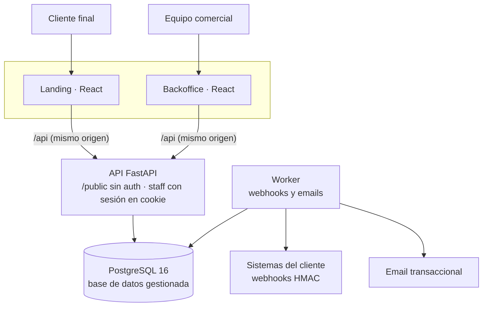
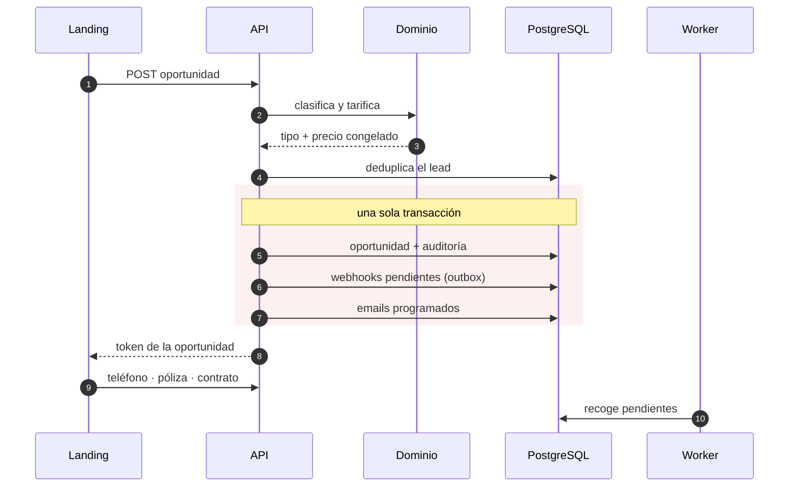
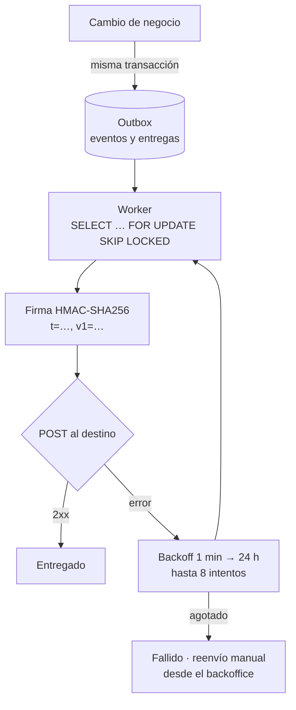
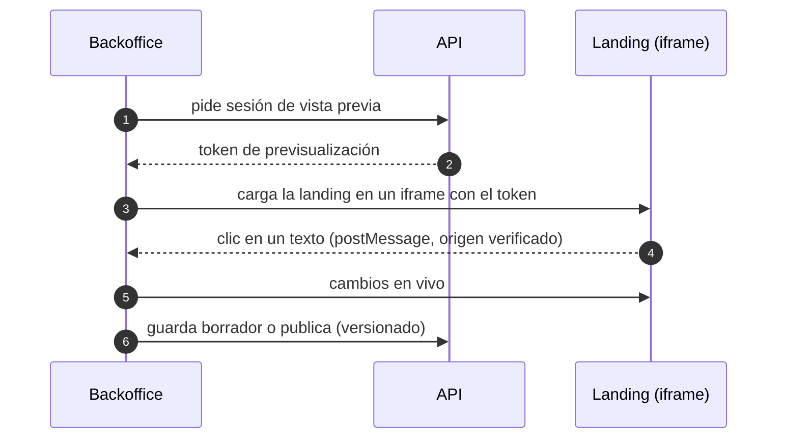

Plataforma con la que una **aseguradora líder en España** vende online su seguro para perros y gatos. La construí de principio a fin —la API, las dos aplicaciones web, la infraestructura y los pipelines— y está **en producción desde octubre de 2026**, dos semanas después del primer commit: 88 commits en 3 repositorios y 16 migraciones de base de datos, con desarrollo asistido por IA (Claude Code).

- **Landing pública de contratación**: cotización en 3 pasos, parrilla de precios para una o varias mascotas con códigos promocionales, solicitud de llamada gratuita, solicitud de póliza, alta online en 2 pasos con 4 periodicidades de pago y un buscador de clínicas veterinarias con mapa.
- **Backoffice para el equipo comercial**, adaptado a móvil: bandeja tipo CRM de leads y oportunidades, métricas, auditoría, usuarios con 4 roles, webhooks, CMS visual de textos y emails, administración de tarifas, red de clínicas y canales de venta.

## Contratación y canales de venta

- **Alta completa**: datos ampliados del tomador (NIF/NIE, provincia deducida del código postal…), fecha de inicio editable y validación de teléfono español. El consentimiento opcional de llamadas comerciales queda registrado en la ficha y viaja en los webhooks y en las exportaciones.
- **Reglas comerciales configurables por canal**: el equipo comercial define desde el backoffice qué flujo ofrece cada origen de tráfico (UTM). La API aplica las mismas reglas, así que no se pueden saltar desde el navegador, y un simulador permite probarlas antes de publicarlas.
- **Buscador de clínicas** sobre la red de clínicas veterinarias de toda España, paginado y con opción «cerca de mí»: la geolocalización se redondea a unos 100 m y nunca se envía a la analítica.

## Arquitectura

- **Capas estrictas y en un solo sentido**: rutas → servicios → repositorios → modelos. Las reglas de negocio (tarificación, permisos, funnel, catálogo de webhooks, esquemas de contenido) viven en una capa de **dominio pura, sin I/O**, que es la única fuente de verdad. Los frontends solo las replican para mostrarlas; la autoridad siempre es el servidor.
- **Mismo origen para cada frontend**: nginx hace de proxy de `/api`, así que la sesión viaja en una cookie `httpOnly` `SameSite=Strict` sin configurar CORS.
- **Infraestructura sencilla y gestionada en GCP**: contenedores Docker, base de datos gestionada en red privada, TLS automático y secretos gestionados. Bitbucket Pipelines construye la imagen y un despliegue scriptado espera a que los servicios estén sanos; la API aplica las migraciones al arrancar.

## Del presupuesto al contrato, en una transacción

- **Tarificación versionada y precio congelado.** El precio se calcula y se guarda en el momento de la cotización; las tarifas y descuentos se versionan por fecha de vigencia (zona horaria Europe/Madrid), así que un cambio de tarifa nunca altera un presupuesto ya emitido.
- **Leads que solo avanzan.** Cada oportunidad se clasifica por tipo y solo puede avanzar. La **deduplicación de leads** agrupa los registros repetidos de una misma persona y deja como principal el más avanzado.
- **Idempotencia en los POST públicos** con `Idempotency-Key`, para que un doble clic o un reintento de red no creen dos oportunidades.

## Webhooks con transactional outbox

Los sistemas del cliente reciben **17 tipos de evento**. Para que un fallo de red nunca pierda ni duplique un evento de negocio, uso el patrón **transactional outbox**:

- El evento se escribe **en la misma transacción** que el cambio que lo origina. Si la transacción falla, el evento no existe; si se confirma, el evento se entregará tarde o temprano.
- `FOR UPDATE SKIP LOCKED` permite varios workers sin entregas dobles.
- Cada destino tiene su propia autenticación (bearer, cabecera propia o básica) además de la firma. Las URLs de destino pasan por una **protección contra SSRF** y los secretos y payloads se guardan cifrados con Fernet.
- La documentación de los webhooks se genera desde los **mismos builders** que producen los envíos reales, y cada evento se puede enviar como prueba desde el backoffice.

Los **emails automáticos** siguen el mismo esquema: el evento crea el mensaje programado y, cuando llega su hora, el worker vuelve a comprobar la condición, el consentimiento, la lista de supresión y la vigencia (descarta lo que tenga más de 48 h). Todo email de marketing lleva un enlace firmado de baja y la cabecera `List-Unsubscribe`.

Los emails de marca se rediseñaron con **piezas dinámicas** (tarifa, resumen por mascota, DNI e IBAN enmascarados), se editan con un **editor visual** desde el backoffice y salen por SMTP a través de un proveedor transaccional.

## CMS visual sin despliegues

El equipo comercial edita los textos de la landing y de los emails **sobre la propia página**, sin tocar código:

- Cada texto editable lleva **marcadores invisibles de ancho cero** que identifican su campo, así que no hace falta instrumentar el HTML a mano.
- El contenido usa un **marcado propio y seguro** (negrita, cursiva, subrayado, colores de marca y enlaces internos), nunca HTML libre. En los emails se convierte en estilos inline.
- Las reglas CSP `frame-ancestors` y `frame-src` solo permiten que estas dos aplicaciones se enmarquen entre sí.

## SEO técnico y buscadores con IA

Las aplicaciones son SPA de React, así que el SEO se resolvió en el build y en la API:

- **Pre-render con Playwright** dentro del build Docker: la portada, el buscador, las páginas legales y la 404 se sirven como HTML completo. El resto de la SPA lleva `noindex` y las rutas inexistentes devuelven un **404 real**.
- **50 páginas por provincia** con las clínicas de cada zona.
- **Datos estructurados JSON-LD**: `InsuranceAgency`, `Service` con `offers`, `FAQPage`, `BreadcrumbList` y cada clínica como `VeterinaryCare`.
- `sitemap.xml` con `lastmod` y `llms.txt` generados desde la API, y un `robots.txt` que admite explícitamente a los crawlers de IA (GPTBot, ClaudeBot, PerplexityBot…).

## Seguridad y privacidad

- **Sesión**: JWT con `jti` en una cookie `httpOnly`, CSRF *double-submit*, contraseñas con argon2, bloqueo progresivo ante intentos fallidos, lista de tokens revocados e invalidación de sesiones al cambiar la contraseña.
- **Datos sensibles** (documento de identidad, IBAN) **cifrados** en la base de datos. Las exportaciones CSV y Excel neutralizan la inyección de fórmulas, los formularios públicos tienen *honeypot* y todas las respuestas llevan cabeceras de seguridad.
- La API **se niega a arrancar** en staging o producción si detecta secretos de desarrollo.
- **Analítica propia y respetuosa con la privacidad**: no se envía nada antes del consentimiento, el backend descarta los datos personales y cada sesión se vincula al lead para ver su recorrido por los 10 pasos del funnel. Las etiquetas de Google Ads, Meta y GA4 solo se cargan con consentimiento de marketing.
- **RGPD**: un comando de retención anonimiza los leads antiguos y purga la analítica vieja.

## Calidad

- **Backend**: 185 tests contra PostgreSQL real, **97 % de cobertura** con ramas y un mínimo obligatorio del 90 %; `mypy --strict`, Ruff con reglas de seguridad, `pip-audit` y `detect-secrets`.
- **Frontends**: 227 tests unitarios (100 en la landing y 127 en el backoffice) con Vitest, Testing Library y MSW, más **36 tests e2e con Playwright** en escritorio y móvil, incluido el flujo de recuperación de contraseña a través de un buzón de pruebas.
- **CI en Bitbucket Pipelines** con pasos paralelos de calidad, seguridad, tests e imagen Docker, y hooks que exigen Conventional Commits, bloquean secretos e impiden commits directos a `main`.
- **Pruebas de carga** antes del lanzamiento para validar el comportamiento de la API bajo concurrencia.
