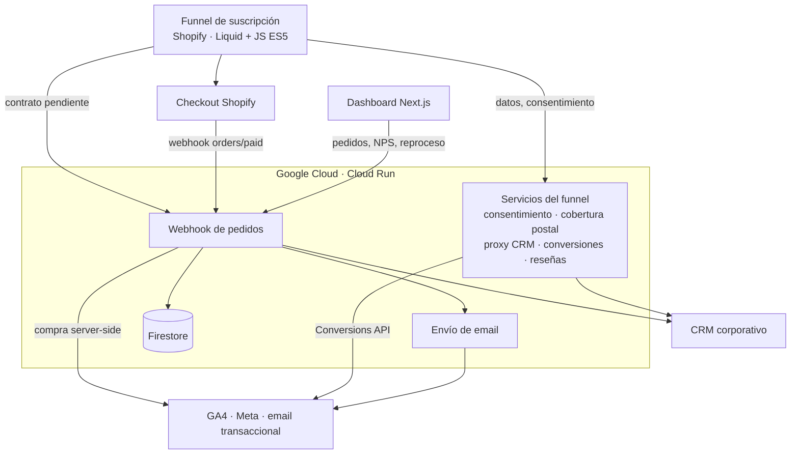
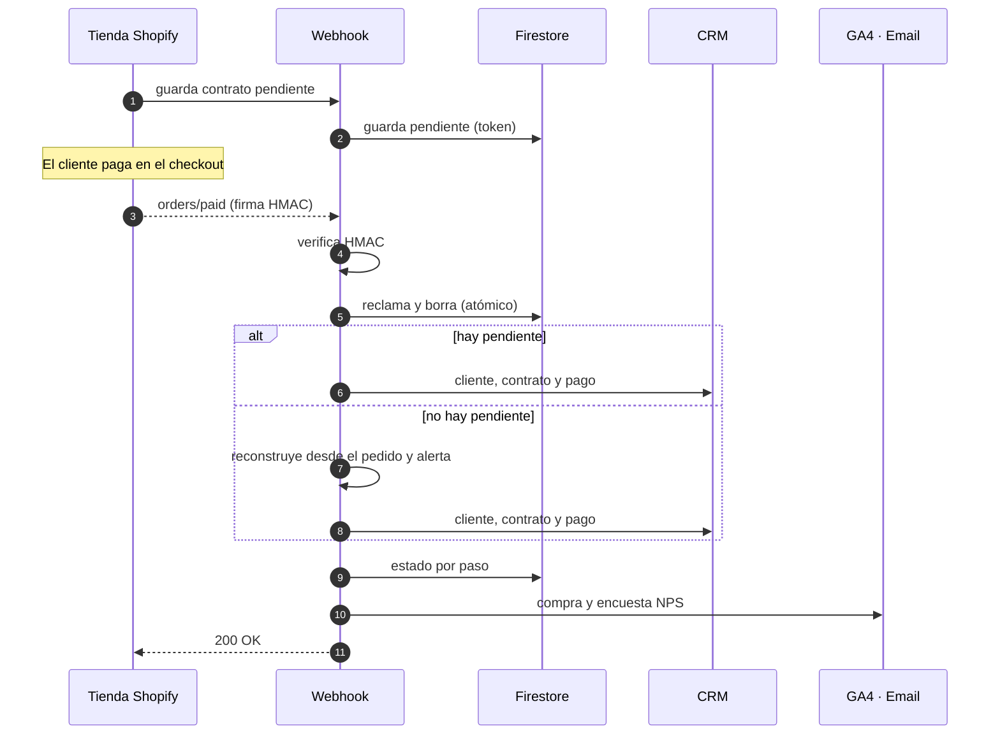
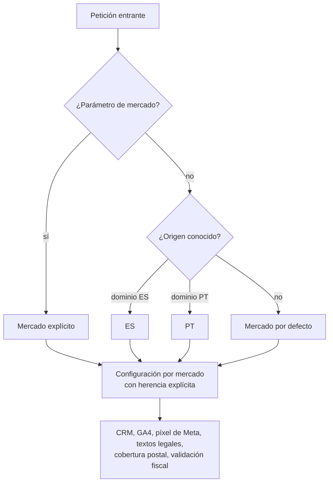
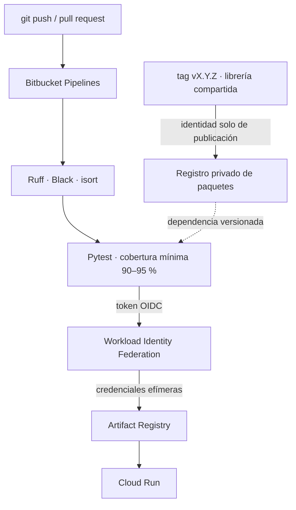

El cliente, una multinacional de tratamiento de agua, vende en línea dispensadores por suscripción: el equipo más las recargas periódicas. El objetivo del proyecto era que **una venta completa ocurriera sin intervención humana**, desde que el cliente elige un plan hasta que el contrato queda dado de alta en el CRM corporativo con su primer cobro registrado.

Fui el responsable técnico y el desarrollador principal: el funnel de la tienda, los microservicios, el dashboard, la infraestructura y la documentación técnica entregada al cliente.

## Arquitectura

El sistema tiene cuatro piezas: una **tienda Shopify** con un funnel de suscripción a medida, **8 microservicios serverless en Google Cloud**, un **dashboard privado** de analítica y operación, y los **sistemas externos** (CRM, pagos, email y medición).

Cada servicio es pequeño y tiene una sola responsabilidad. Todos comparten una **librería interna compartida y versionada** que resuelve lo transversal: routing declarativo, sobre de errores uniforme, políticas de autenticación, CORS, logging sin datos personales y cliente del CRM. Completan el ecosistema un servicio de tickets en FastAPI y una CLI de migración de tienda.

## El webhook de pedidos: contratos solo después del pago

La decisión de arquitectura más importante fue **crear el contrato en el webhook de pago**, de modo que en el CRM solo existen contratos con un pago confirmado.

El funnel guarda un **contrato pendiente** en Firestore, identificado por un token imposible de adivinar asociado al carrito. Shopify confirma el pago con el webhook `orders/paid` y el backend completa todo el alta:

Qué hace robusto a este flujo:

- **Autenticación fail-closed.** El endpoint del webhook exige la firma HMAC de Shopify calculada sobre el body crudo y rechaza la petición ante cualquier configuración incompleta.
- **Deduplicación atómica.** Shopify garantiza la entrega *at-least-once*: reintenta hasta 19 veces en 48 h y puede entregar el mismo evento dos veces casi a la vez. El pendiente se reclama y se borra dentro de una transacción de Firestore, así que solo una entrega puede crear el contrato.
- **Reconstrucción.** Si falta el contrato pendiente, se reconstruye desde el pedido y se genera una alerta en Sentry para su seguimiento.
- **Estado por paso e idempotencia.** Un registro de estado por pedido guarda por separado el contrato, el pago, GA4 y el NPS. El botón **"Reprocesar"** del dashboard reintenta solo los pasos fallidos, nunca duplica la analítica y es la única acción manual con permiso de escritura en el CRM.
- **Recuperación automática.** Un reproceso programado reintenta los pedidos fallidos de las últimas 48 h, por mercado y de forma idempotente. Otro job programado reintenta los leads que no se pudieron registrar en el CRM.
- **Integración robusta con el CRM corporativo.** Timeouts explícitos, idempotencia propia con una cabecera `Idempotency-Key` y TLS verificado.

## Un código, dos mercados

La expansión a **Portugal** se diseñó como multi-mercado desde el código, no como una copia del proyecto:

- El **tema de Portugal** (repositorio propio, 113 commits) se clonó del de España y se tradujo a **portugués europeo**: un diccionario de unas 200 claves que conserva las claves de analítica y traduce solo los valores, con una revisión manual de traducciones documentada.
- Centralicé la **validación de formatos portugueses** (teléfono, código postal `NNNN-NNN` con autoformato y NIF), que sustituyó unas 30 validaciones duplicadas.
- **Analítica separada por país**: GA4 y píxel de Meta propios y Meta CAPI server-side por mercado. Portugal tiene además su propio consentimiento de cookies, sus políticas legales, su catálogo y precios del CRM y sus reseñas de Google por mercado e idioma.
- **Cobertura postal por producto** con un modelo *deny-list*: los códigos postales inexistentes y las zonas no servidas (islas) se rechazan antes del pago.
- Construí una **CLI de migración de tienda** (productos, colecciones, metafields y los metaobjects referenciados) sobre la **Shopify Admin GraphQL API**, con OAuth y verificación de los scopes y de la tienda del token antes de escribir. Es idempotente, ejecuta primero en modo *dry-run*, pagina más allá del límite de 250 nodos, traduce el copy pero nunca los handles y es no destructiva por diseño: entre sus 80 tests hay uno que garantiza que no contiene ninguna mutación de borrado.
- Cada servicio tiene un **despliegue dedicado por mercado**. Los dos mercados comparten Firestore y cada pedido queda etiquetado con su mercado.

## CI/CD sin llaves y calidad

- **Ninguna llave de cuenta de servicio almacenada.** El CI se autentica en GCP con tokens OIDC de Bitbucket y Workload Identity Federation. Hay una identidad de solo lectura para todos los repositorios y otra de publicación ligada únicamente al repositorio de la librería, lo que protege la cadena de suministro.
- **Cobertura mínima obligatoria** en cada servicio, entre el 90 y el 95 % (la medida está entre el 94 y el 99 %), con **más de 1.100 tests**. Ninguno toca red ni base de datos reales: los adaptadores se inyectan.
- **Un `deploy.sh` por servicio**: exige un árbol git limpio, ejecuta los tests, construye la imagen, hace un *smoke test* del contenedor antes de desplegar y admite elegir el mercado de destino.
- **Guard de despliegue del tema**: el push se niega si el tema en vivo se editó en el admin de Shopify desde el último despliegue, para no pisar esos cambios.
- **Una auditoría OWASP Top 10** con 10 hallazgos corregidos alimentó el diseño de la librería: autenticación en todos los endpoints, HMAC *fail-closed*, CORS restringido, escape de contenido de terceros frente a XSS, secretos fuera del código y TLS verificado hacia el CRM. Las políticas de autenticación son declarativas y *fail-closed* por defecto (pública, por origen de navegador, secreto compartido comparado en tiempo constante, HMAC de Shopify) y los errores nunca exponen detalles internos.

## Medición server-side y navegadores embebidos

- La compra se envía a **GA4 por Measurement Protocol** desde el backend, con el `client_id` y el `session_id` del navegador para no perder la atribución. Los eventos de **Meta Conversions API** se deduplican contra el píxel del navegador con un `event_id` compartido, y los datos personales viajan hasheados.
- **Compatibilidad con navegadores embebidos de apps** y con Samsung Internet: el funnel está escrito en **ES5** (sin `async/await` ni `?.`) y, con **Sentry Session Replay**, diagnostiqué y resolví un problema de renderizado específico de esos navegadores. El botón de pago lanza llamadas en paralelo con timeouts estrictos y un *warm-up* que evita los arranques en frío de 2–3 s.

## Dashboard de operación y tickets

Dos piezas del ecosistema tienen su propio caso de estudio:

- **[Dashboard de analítica y operación](../dashboard-analitica/)**: dashboard en Next.js que carga 23 informes de GA4 en paralelo, reconstruye el funnel, diagnostica anomalías diarias con un modelo de Poisson y permite reprocesar pedidos con un clic.
- **[Gestión de mantenimiento con SLA](../tickets-mantenimiento/)**: el servicio en FastAPI que sustituyó un flujo low-code basado en hojas de cálculo, con máquina de estados, IDs transaccionales, SLA y bolsa de horas.

## Resultados

- La venta online funciona **de punta a punta sin intervención manual** y cada contrato del CRM tiene un pago confirmado.
- Hay **visibilidad completa** de cada pedido, reproceso automático programado y recuperación con un clic cuando falla un sistema externo.
- El segundo país se lanzó **sin duplicar el código base**.
- Los 8 microservicios comparten una base común auditada, con CI/CD sin secretos y más de 1.100 tests.
- Entregué un **manual técnico** de unas 1.300 líneas con 12 diagramas generados desde código.
